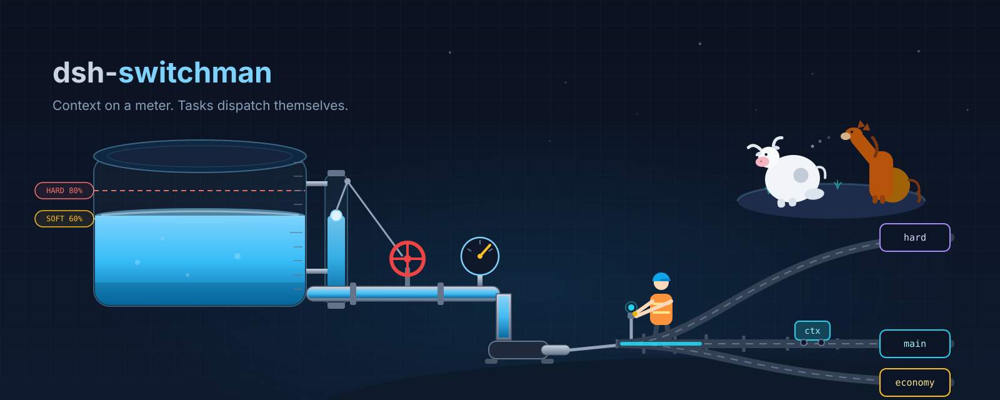

# dsh-switchman

[English](./README.md) | [简体中文](./README.zh.md) | [繁體中文](./README.zh-TW.md) | [日本語](./README.ja.md) | [한국어](./README.ko.md) | [Español](./README.es.md) | [Français](./README.fr.md) | **Deutsch** | [Italiano](./README.it.md) | [Português](./README.pt.md) | [Русский](./README.ru.md)

> **Die Switchman-Familie**, gleicher Autor, gleiche Dispositions-Philosophie: [opencode-switchman](https://github.com/mrzturn/opencode-switchman) (das OpenCode-Original) · [zcode-switchman](https://github.com/mrzturn/zcode-switchman) (die ZCode-Portierung) · **dsh-switchman** (dieses Repo, die DeepSeek-Harness-Edition).



> Dem Kontext einen Wasserzähler geben; jede Aufgabe findet ihre Spur von selbst.

## Warum dsh-switchman?

Wer lange mit DSH arbeitet, ärgert sich über zwei Dinge. Erstens werden Sessions mit der Zeit schwer: Die Historie bläht den Kontext auf Hunderttausende Token, das Modell vergisst, wird langsam und teuer, und ein manuelles /compact verliert Details. Zweitens erledigt das Hauptmodell alles selbst — Dateien nachschlagen, Tests laufen lassen, Daten abgleichen —, obwohl der Großteil dieser Arbeit auf ein billigeres Modell gehörte.

dsh-switchman ist ein Plugin für [DeepSeek Harness](https://github.com/deepseek-ai/deepseek-harness) (DSH). Nach der Installation wandelt sich das Hauptmodell vom Selbermacher zum Disponenten: Wasserstand messen, Spur wählen, Aufgaben vergeben, Abnahme prüfen. Es ist kein neues Modell, sondern ein Dispositionsregelwerk an DSH plus eine Einstellungsseite — und es tut acht Dinge:

**1. Kontext-Wasserstand: lange Sessions platzen nicht.** Jede Runde zählt die Session-Tokens in Echtzeit; drei Stufen schrauben sich hoch: 80k (soft, einstellbar) mahnt „zeit zu delegieren“; 95k (hard) strafft das Einzellese-Budget und lenkt auf den Abschluss; 150k (force) übergibt automatisch — das Übergabedokument wird geschrieben (das append-only Sitzungslog ist dabei die vollständige Sicherung), der Kontext komprimiert, die Session geweckt und läuft weiter, ohne dass die Aufgabe abreißt. Auch Hintergrund-Subagents, die im Moment der Übergabe noch laufen, gehen nicht verloren: id, Aufgabe und Report-Pfad landen im Übergabedokument; die fortgesetzte Session weiß, wo sie Reports abholt, und vergibt nichts doppelt. Jeder Subagent trägt eine eigene harte Obergrenze und verlässt nach seinem HANDOFF-Summary die Bühne. Passt dir die automatische Intervention nicht, übernimm jederzeit von Hand: `/ctx-pause` stoppt alle Wasserstands-Aktionen (die Messung läuft weiter, die Live-Wasserstandszeile am Ende springt auf paused — es wird nur nicht mehr gehandelt), `/ctx-resume` holt alles jederzeit zurück — nach einem DSH-Neustart greift die Intervention auch von selbst wieder, ein temporäres Loslassen, kein Dauer-Aus; `/ctx-handover` wartet nicht, bis der Wasserstand oben ist, und startet dieselbe Übergabe auf Zuruf: Übergabedokument schreiben, Kontext verdichten, Session zum Weiterlaufen wecken (die Session wird erst an eine Leerlauf-Grenze geführt, das Ergebnis kann daher ein paar Minuten dauern).

**2. Sechs Dispatch-Pools: das richtige Modell für jede Arbeit.** Economy (Massen-Kleinkram), Mechanical (Schablonen-Umformung), Main (tägliche Codearbeit), Hard (schwere Schlussfolgerungen und große Refactorings), Vision (Bilder), Review (unabhängige Prüfung). Auf der Einstellungsseite kreuzt man Kandidaten an, ordnet Prioritäten, vergibt Noten S/A/B/C und nagelt je Route einen Reasoning-Aufwand fest — das Aufwand-Dropdown führt die Stufen, die das Modell tatsächlich beherrscht, nicht generische drei. Im Prompt jeder Runde steckt eine `[SWITCHMAN:POOLS]`-Empfehlungstabelle; nach der wird vergeben. Drei Enforcement-Modi: aus / Empfehlung / Erzwingen (Erzwingen = Modelle außerhalb der Pools werden glatt abgelehnt).

**3. Agent-Teams-Modus: vom Einzeltäter zum Team.** Standardmäßig aus — nach der Installation ist es schlanke Subagent-Vergabe. Zwei unabhängige Schalter auf der Einstellungsseite:

- **Agent-Teams** — eingeschaltet injiziert das Team-Regelwerk (Delegation als Standard + gestufte Verifikation + Disziplin fürs gemeinsame Task-Board) und aktiviert die Agent-Teams-Funktion von DSH automatisch: das Hauptmodell rekrutiert Dauerteammates (`spawn_teammate`), legt Aufgaben auf das gemeinsame Task-Board (`team_task_*`) und tauscht Nachrichten mit Teammates aus. Wann ein Team fällig ist, ist klar geregelt: parallelisierbare unabhängige Subtasks, große in sich abgeschlossene Mengen, hoher Wasserstand im Hauptkontext, nötige Rollentrennung; einmalige Punktuntersuchungen bleiben beim Subagent. Wieder ausgeschaltet verschwinden die Team-Klauseln restlos, und laufenden Sessions werden die Team-Werkzeuge nie entrissen.
- **Whitelist-Sync für Subagent-Modelle** — DSH führt eine Autorisierungs-Whitelist „Agenten dürfen Modelle für Subagents wählen“: in einem Pool gewählte, aber nicht autorisierte Routen werden bei namentlicher Vergabe abgelehnt (im Teams-Modus mit ⚠ markiert). Dieser Schalter schreibt die Vereinigung aller sechs Pools en bloc in ebendiese Whitelist — switchman ist die einzige Quelle der Wahrheit, doppelte Konfiguration entfällt. Die Whitelist gilt als Snapshot je neuer Session; der Sync wirkt nur auf danach gestartete Sessions.

Die Session-Kopfzeile zeigt sofort, was los ist: das ⚡-Abzeichen „autonomes Team“ und ◇ mit dem tatsächlich genutzten Modell der Session; während einer laufenden Auto-Übergabe erscheint live „Übergabe läuft · Übergabedokument schreiben / Kontext komprimieren / Nachfolger wecken“.

**4. Sprachpräferenzen: einmal fragen, für immer merken.** Je ein Dropdown für Antworten, Code-Kommentare und Dokumente; Geltungsbereich global oder je Projekt (`.switchman/lang.json`). Leer lassen geht auch — beim ersten Einsatz wird einmal in der Sprache deiner DSH-Oberfläche gefragt, danach hält sich jede Session daran.

**5. Oberflächensprache: das Plugin selbst spricht mit.** Oben auf der Einstellungsseite, im Bereich „Oberfläche“, sitzt das Dropdown „Oberflächensprache“ (Setting-Schlüssel `uiLocale`): Auto (Standard, folgt der Sprache der DeepSeek-Harness-App) oder jede eingebaute Oberflächensprache nach Wahl — die Optionen erscheinen stets als Eigenname der Sprache, unübersetzt. Umgeschaltet wird nur die Oberfläche des Plugins selbst (Abzeichen, Home-Panel, Einstellungsseite), nie die Sprache der DSH-App: die Auswahl ist sofortige Live-Vorschau ohne Neustart, wird nach dem Speichern gemerkt und beim nächsten Start wiederhergestellt, und jeder Fehler fällt auf die App-Sprache zurück; die Wörterbücher liegen vollständig im Plugin-Bundle, kein Download.

**6. Gestufte Verifikation: jede Änderung wird geprüft.** Änderungen über 20 Zeilen gehen an einen Tester; über 300 Zeilen oder an Kern- / Sicherheits- / Datenkonsistenz-Logik zusätzlich an einen unabhängigen Reviewer. Das Review-Modell wird am Modell des „Agents, der den Diff geschrieben hat“ verankert und möglichst vermieden; wenn der Pool es nicht hergibt, wird im Ergebnis DOWNGRADED deklariert. Ein „nutz kein Team“ genügt — sofort wieder Einzeltäter.

**7. `/vision`: reine Textmodelle kriegen trotzdem Bilder.** Kann das Hauptmodell keine Bilder lesen, lehnt DSH Bildnachrichten an der Tür ab. Bild einfügen, `/vision was ist an diesem Bild falsch` eintippen — das Bild geht an ein Modell aus dem Vision-Pool, das Urteil kommt in die laufende Session zurück. Über dem Eingabefeld steht vorab „das aktuelle Modell kann keine Bilder lesen“; wird der direkte Bildversand abgelehnt, wird die Nachricht automatisch als `/vision` umgeschrieben und erneut gesendet — kein manueller zweiter Versuch. Ohne konfigurierten Vision-Pool verweigert der Befehl und weist auf die Einstellungen.

**8. Intent-Routing: das passende Modell stellt sich von selbst ein.** Auf der Einstellungsseite gibt es eine neue Gruppe „Intent-Routing“: einen Hauptschalter (standardmäßig aus — zum Einschalten sind ein Klassifikator und mindestens ein Kandidat nötig), die Small-Model-Route des Klassifikators (Provider + Modell + optionaler Aufwand — TypeSafe-Jev-artige Entscheidungsmodelle wie allgemeine Chatmodelle funktionieren gleichermaßen, die Ausgabe wird tolerant geparst), eine Dreifachwahl des Klassifikatortyps (auto / decision / chat), eine eigene Kandidatenliste (je Kandidat Provider + Modell + optionaler Aufwand + eine Zeile Fähigkeitsbeschreibung), das Cache-Fenster in Sekunden (Standard 300, abgestimmt auf die Prompt-Caches der Anbieter von rund 5 Minuten), die Umschalt-Vertrauensschwelle (Standard 80), das Klassifikations-Timeout (Standard 60000 ms), die Anzahl der Verlaufsnachrichten (Standard 6) samt Zeichenbudget (Standard 2400) und ein optionales Fallback-Modell. In der Modellauswahl erscheint unter der Gruppe „Auto · Switchman“ der Eintrag „Auto“ (der Client rendert ihn lokalisiert — auf Deutsch „Automatisch (Intent-Routing)“); ist er gewählt, stuft der Klassifikator jede Nutzernachricht ein und der Entscheid gilt für die jeweilige Runde: Bei zu geringem Vertrauen oder noch offenem Cache-Fenster bleibt das aktuelle Modell in Verwendung (sein Cache wird weitergenutzt); gewechselt wird erst, wenn das Vertrauen hoch genug ist oder das aktuelle Modell nicht unter den Kandidaten steht. Der Wechsel geschieht still auf der Aufrufebene — keine „Modell gewechselt“-Nachricht landet in der Session. Über dem Eingabefeld sitzt ein Status-Chip (bei aktivem Routing zeigt er das aktuelle Routing-Modell und das Vertrauen der letzten Entscheidung); Kandidaten und Schwellen stehen jederzeit auf der Einstellungsseite.

Auch mit nur einem Modell lohnt sich die Installation — Wasserstandskontrolle und gestufte Verifikation hängen nicht von der Modellzahl ab; lange Single-Model-Sessions profitieren genauso.

## Mitgelieferte Skills

- **db-query** — Nur-Lese-Prüfung für MySQL / Redis: SQL-Abgleiche fahren, Cache-Keys / TTL nachschlagen, Konsistenz über Datenbanken hinweg prüfen; jede Schreiboperation wird abgelehnt. Vor der ersten Nutzung einmalig initialisieren (siehe unten).
- **git-commit-message** — erzeugt regelkonforme Commit-Texte; nur Text, nie git.
- **requirement-docs** — der einheitliche Standard für Anforderungsanalyse / PRD / Design-Dokumente; Ergebnisse werden nach `docs/requirements-and-design/` archiviert.

## Schnellstart

1. **Installieren** — in einer beliebigen Session den Agent ranlassen oder über die Plugin-Verwaltung der Web-Oberfläche:

   ```
   plugin_manager: install_bundle  target=dsh-switchman
   ```

   Oder aus einem lokalen Checkout installieren (link-Modus; nach einem Update per `remove_bundle` + `install_bundle` neu installieren):

   ```
   plugin_manager: install_bundle  target=/path/to/dsh-switchman
   ```

   Oder im Terminal mit dem `dsh`-Befehl — das Profil passend zur Betriebsart wählen:

   ```bash
   dsh plugin --profile web add dsh-switchman      # Web GUI
   dsh plugin --profile desktop add dsh-switchman   # Desktop-App
   ```

2. **DSH neu starten** — die App vollständig beenden und wieder öffnen (ein Seiten-Reload zählt nicht); erst dann erkennt die Client-Modultabelle das Bundle.

3. **Konfigurieren** — Einstellungen → dsh-switchman oder das „Switchman-Dispatch-Center“ in der Startseiten-Seitenleiste. Die Konfiguration ist eine einzige Seite und sieht so aus — einmal von oben nach unten durchgehen, fertig:

   

   - **Oberfläche** — die Oberflächensprache des Plugins selbst. Im Screenshot steht das Dropdown auf „Deutsch“ — eine Live-Vorschau des Umschaltens; der Auslieferungs-Standard ist Auto (folgt der App-Sprache von DSH). Eine gewählte Sprache schaltet die Seite sofort um und wird nach dem Speichern gemerkt; jederzeit zurück auf Auto.
   - **Sprachen** — die Sprachen der Agent-Ergebnisse. Der Geltungsbereich steht im Screenshot auf „Global (dieses Profil)“ (je Projekt ebenfalls möglich, jedes liest `.switchman/lang.json`); die drei Dropdowns Antwort / Code-Kommentare / Dokumente stehen im Screenshot alle auf Deutsch, jedes angezeigt als „Eigenname (Tag)“ — z. B. „Deutsch (de)“ — mit einer Statuszeile „aktuell: …“ darunter. Alle drei leer lassen geht auch — beim ersten Einsatz wird einmal gefragt, danach gemerkt.
   - **Dispatch-Pools** — sechs Karten in zwei Reihen zu drei: oben Economy / Mechanical / Main, unten Hard / Vision / Review. Kandidaten je Provider ankreuzen; ein Haken bei „manuelle Reihenfolge“ macht daraus eine nummerierte Prioritätsliste, sortiert mit ↑ ↓ ×; je Route lässt sich der Reasoning-Aufwand festnageln (Standard „wie Spur“). Die Zusammenfassungszeile oben aktualisiert live — im Screenshot: „4/6 Pools konfiguriert · 2 gerankt · Modus Empfehlung“.
   - **Fähigkeits-Ranking + Enforcement-Modus** — die Vereinigung der gewählten Modelle über alle sechs Pools, nach Fähigkeit sortiert, das stärkste zuerst (im Screenshot glm-5.3 auf S und glm-5.3-flash auf A verankert), umsortier- und kürzbar; Enforcement-Modus Empfehlung / Erzwingen (Erzwingen = Modelle außerhalb der Pools werden glatt abgelehnt).
   - **Agent-Teams** — die zwei Schalter für Team-Modus und Whitelist-Sync, beide standardmäßig aus; im Screenshot an, mit Sync-Statuszeile unter dem Schalter.
   - **Kontext-Wasserstand** — die drei Schwellen (im Screenshot 80000 / 120000 / 150000), das Einzellese-Budget (3000), das Verhalten der Hard-Stufe (drosselnd durchlassen / blockieren), der Schalter für die Auto-Übergabe und die eigenen Obergrenzen der Subagents — alles in diesem Bereich. Unten die Befehlszeile: `/ctx-pause` Eingriffe pausieren · `/ctx-resume` fortsetzen · `/ctx-handover` Übergabedokument schreiben und sofort übergeben (die Session wird erst an eine Leerlauf-Grenze geführt und dann komprimiert — das Ergebnis kann ein paar Minuten dauern).
   - **Intent-Routing** — der Hauptschalter, die Small-Model-Route des Klassifikators, der Klassifikatortyp (auto / decision / chat), die eigene Kandidatenliste (je Eintrag eine Zeile Fähigkeitsbeschreibung), Cache-Fenster / Vertrauensschwelle / Klassifikations-Timeout / Verlaufsbudget und ein optionales Fallback-Modell. Eingeschaltet erscheint in der Modellauswahl der lokalisierte Eintrag „Automatisch (Intent-Routing)“, und der Status-Chip über dem Eingabefeld zeigt Routing-Modell und Vertrauen.

4. **Prüfen** — in der Session-Kopfzeile erscheint das ⚡-Abzeichen „autonomes Team“ (daneben ◇ mit dem Modell der Session); oder das Modell einfach fragen: „Wie lautet die Überschrift des letzten Abschnitts deines System-Prompts?“ — die Antwort sollte das dsh-switchman-Regelwerk nennen.

**Einmalige Initialisierung von db-query** (Skript-Abhängigkeiten landen im Skill-Verzeichnis und verschmutzen das Projekt nicht):

```bash
bash <Installationsverzeichnis>/skills/db-query/scripts/setup.sh
```

**Empfehlung zur Klassifikator-Wahl:** Wer das Entscheidungsmodell lokal betreiben will, fährt am besten `d3:4b-mxfp8` mit Ollama — als Klassifikatortyp „Entscheidungs-Endpunkt (systemone)“ wählen, als Endpunkt `http://127.0.0.1:11434/v1/systemone` und als Modellnamen `d3:4b-mxfp8` eintragen. Für den Chat-Klassifikator aus dem LLM-Katalog empfiehlt sich ein kleines Cloud-Modell oder ein kleines lokales Modell ohne Thinking- (Reasoning-)Fähigkeit — abgeschaltetes Thinking senkt Latenz und die Timeout-Fehlerrate der Klassifikation zugleich.

## Standardkonfiguration

Alles Folgende sind die vollständigen Werte direkt nach der Neuinstallation (maßgebliche Quelle: das zod-Schema in `host/config.js`).

**Oberfläche und Sprachen**: `uiLocale` = `auto` (folgt der Sprache der DSH-App); `langScope` = `global`; `langConversation/Comments/Docs` = leer (in der ersten Session einmal gefragt, dann gemerkt; die Sprache von Kommentaren und Dokumenten folgt der Konversationssprache).

**Dispatch-Pools**: alle sechs Spuren (economy/mechanical/main/hard/vision/review) starten ohne Kandidaten (= die Standardmodelle des Systems, keine Einwirkung); manuelle Reihenfolge und gepinnter Aufwand sind aus/leer; `dispatchEnforce` = `advice` (nur Empfehlung, nichts wird erzwungen).

**Kontext-Wasserstand**: soft `80000` / hard `95000` / force `150000` Token; Einzellese-Budget `3000`; Verhalten bei Budgetüberschreitung `cap` (kürzen mit Warnung); `wmAutoHandover` = an (bei force Übergabedokument schreiben + Komprimierung, automatisch); die harte Obergrenze für Subagents = an (gemeinsame 150k).

**Agent Teams**: `teamsMode` = aus; `syncWhitelist` = aus (die beiden Schalter sind unabhängig voneinander).

**Intent-Routing** (ab Werk unbrauchbar; nötig sind Klassifikator + mindestens ein Kandidat + der Hauptschalter): `intentEnabled` = aus (ist er aus, bleibt der Auto-Eintrag verborgen, und Sessions, die bereits Auto gewählt hatten, laufen über die Fallback-Kette); Klassifikator-Route nicht gesetzt; Klassifikatortyp `chat`; Kandidatenliste leer (die mitgelieferten Kategorien nehmen erst mit eingetragenem Modell am Routing teil); Cache-Fenster `300` s / Umschalt-Vertrauensschwelle `80` / Klassifikations-Timeout `60000` ms; Verlauf `6` Nachrichten / `2400` Zeichen; `intentContextWindow` = `200000`.

**Kontext-Trimming**: `trimEnabled` = an; `trimMode` = `auto` (vollautomatisch); Wachstumsschwelle `22500` + Zuwachs `50000` Tokens; Druck `60%` / Notfall `95%`; geschütztes Ende `6` Nachrichten; Fold-Takt-Obergrenze `6` pro Stunde; Nebenmodell nicht gesetzt (erbt das Session-Modell) — Details im Abschnitt „Automatisches Kontext-Trimming“ unten.

**Out-of-the-Box-Anmerkungen**: ① dass Intent-Routing ab Werk unbrauchbar ist, ist Absicht — drei Schritte zum Einschalten (Klassifikator, Kandidaten, Schalter); ② das wirksame Auto-Fenster steht ab Werk auf 200000 — die Leitplanke garantiert 0.8×Fenster ≥ force (150000), die Kern-Komprimierlinie (160000) liegt also stets hinter der Linie der weichen Übergabe (150000); ③ am spürbarsten ab Werk ist das Wasserstands-Trio: 80k mahnt zur Delegation / 95k strafft das Lesen / 150k übergibt automatisch (Dokument schreiben + Komprimierung) — ganz ohne Einstellungen.

## Automatisches Kontext-Trimming

Lange Sessions bleiben günstig: verarbeitete Gesprächsbereiche werden zu kompakten deterministischen Zusammenfassungen gefaltet — vollautomatisch und ohne den Prompt-Cache des Anbieters zu brechen. An einer Leerlauf-Grenze wählt die Trim-Engine (`host/context-trim/`) die faltenswerten Bereiche, ein Nebenmodell schreibt die Zusammenfassung (nur unter Notfall-Druck greift stattdessen ein mechanischer Fold ohne Nebenmodell-Aufruf), und der Fold wird in den Fold-Zustand der Session committet. Von da an wird jede ausgehende Anfrage aus diesem Zustand neu aufgebaut — Zusammenfassungsblöcke ersetzen die gefalteten Bereiche, der lebende Tail bleibt unangetastet. Die gespeicherte Session wird nie umgeschrieben, und mitten im Stream passiert niemals etwas.

Automatisierungsstufen (`trimMode`):

- **`off`** — nur messen: Usage- und Cache-Hit-Sampling läuft weiter; kein Banner, keine Folds.
- **`advisory`** — das Session-Modell faltet selbst: die Tools `ctx_trim_fold` und `ctx_trim_status` plus der Protokollkopf werden dafür freigegeben.
- **`auto`** (Standard) — alles darüber hinaus plus automatische Folds an der Leerlauf-Grenze, in drei Stufen: eine Wachstumsschwelle (Zuwachs > `trimGrowthTokens`, gemessen ab dem Tiefpunkt nach dem letzten Fold — der Anker, der die Schwelle nach Folds auf hohem View-Stand scharf hält — UND ein zusammenhängender komprimierbarer Zuwachs ≥ `trimIncrementTokens`), eine Druckstufe (`trimPressurePercent` des Kontextfensters) und eine Notfallstufe (`trimEmergencyPercent` — ein mechanischer Fold mit eigener Abklingzeit).

Alle Schlüssel liegen unter Einstellungen → dsh-switchman; Defaults aus `host/config.js`:

| Schlüssel | Standard | Bedeutung |
| --- | --- | --- |
| `trimEnabled` | `true` | Hauptschalter. AUS deaktiviert Folds und Metriken komplett (der Listener wird zum reinen Durchreichen). |
| `trimMode` | `auto` | `off` nur messen / `advisory` modellgetriebene Folds / `auto` systemgetriebene Folds. |
| `trimGrowthTokens` | `22500` | Wachstumsschwelle: falte, wenn die ausgehende View seit dem letzten Fold so viel gewachsen ist. |
| `trimIncrementTokens` | `50000` | Schwellen-Begleiter: der zusammenhängende komprimierbare Zuwachs muss ebenfalls diese Größe erreichen. |
| `trimPressurePercent` | `60` | Druckstufe: falte, wenn die View-Nutzung diesen Prozentsatz des Kontextfensters erreicht. |
| `trimEmergencyPercent` | `95` | Notfallstufe: erzwungener mechanischer Fold (kein Nebenmodell-Aufruf) bei diesem Prozentsatz. |
| `trimWindowTokens` | `0` | Effektives Fensterlimit für die Stufenberechnung: gerechnet gegen min(Modellfenster, Limit). `0` = folgt `wmForceTokens`. |
| `trimProtectedTail` | `6` | Die letzten N Nachrichten werden nie gefaltet. |
| `trimMaxFoldsPerHour` | `6` | Fold-Takt-Obergrenze pro rollierender Stunde für Nebenmodell-Folds (Notfall-Folds ausgenommen). |
| `trimSideModel` | nicht gesetzt | Route des zusammenfassenden Nebenmodells. Leer = das aktuelle Session-Modell erben. |
| `trimFoldFallbackModel` | nicht gesetzt | Route, mit der der Fold den Zusammenfassungs-Versuch wiederholt; scheitert auch sie, degradiert ein Pressure-Fold zu mechanischem Folding. Leer = kein Fallback. Route mit Spielraum bei Cooldowns, Risikokontrolle und Concurrency wählen. |
| `trimStateDir` | nicht gesetzt | Überschreibt das Fold-Zustandsverzeichnis. Leer = `<dshHome>/.dsh-switchman/state/trim/`. |
| `surfaceFold` | `true` | Liefert committete Folds auf die Session-Oberfläche aus (Shadow-Price-Messereignis + `surfaceOp`-Replace-Ereignispaar). OFF behält die rein gesplicte View. |

**Trigger-Pfade.** Stufenprüfungen laufen an der Leerlauf-Grenze und — als Fallback für Hosts, auf denen Leerlauf-Status-Ereignisse nicht erreichbar sind — nach jedem Modell-Stream-Abschluss (auf eine Auswertung pro 60 s und Session gedrosselt). Jede Entscheidung — Folds wie No-ops gleichermaßen — wird als eine zeitgestempelte `key=value`-Zeile an `decisions.log` im Fold-Zustandsverzeichnis (siehe `trimStateDir`) angehängt und gibt Folds so eine Offline-Prüfspur; das Zeilenvokabular (`view-applied`, Fold-Entscheidungs-/Ergebniszeilen, `surface-replace`, `surface-replace skipped reason=…`) ist in [docs/context-trim.md](./docs/context-trim.md) katalogisiert.

**Leitungs-Wahrheit und stabiler Zustand.** Entscheidungszeilen tragen `view=<n>` und, sobald eine Antwort eingetroffen ist, `wire=<n>` — den echten Anbieter-Prompt (ungecachter Input + Cache-Read + Cache-Write, entnommen aus dem Usage-Event des Streams). Die View-Schätzung zählt nur das Messages-Array und liest immer um den festen Overhead kleiner als die Leitung (gemessen ≈ 17.3k: System-Prompt + Tool-Schemas + Persona); Druck- und Notfallstufe werten daher auf `max(view, wire)` aus, und nur `wire` ist eine Prompt-Größenmessung. In einem 150k-Fenster läuft der gesunde Sägezahn direkt nach einem Fold auf Leitung ≈ 40k ↔ 88–90k beim nächsten (≈27%–60% des Fensters), ein Fold pro ~50k Rohwachstum, wobei die Obergrenze eher von der Druckstufe als vom Fenster nahe 90k festgehalten wird. Steigt `view`, ohne dass je eine `surface-replace`-Zeile erscheint, lies die Skip-Zeilen (`incomplete-seqs`, `no-service`, `compaction-lock`).

**Host-Kompaktions-Epochen.** Fold-Verweise sind an Nachrichten-IDs und Inhalts-Hashes verankert; ersetzt der Host selbst den erneut gesendeten Verlauf, veralten sämtliche Blöcke auf einmal: keiner findet mehr seine Position, die View fällt still auf den Rohverlauf zurück (fail-open — das Entscheidungsprotokoll vermerkt `view-applied applied=0`), und das Plugin verankert seine Wachstumsbaseline bei der nächsten Anfrage auf der Sicht nach der Kompaktion. Die Host-Kompaktion ist damit die Backstop-Trimschicht; die Plugin-Folds leisten die feingranulare Arbeit innerhalb einer Host-Epoche. Manche Dispatches übergeben vollständig eingefrorene Anfrage-Arrays oder Optionsobjekte (die aktuelle Agent-Loop friert die zusammengesetzten Anfragen tief ein); für sie meldet `injectView` das Ergebnis im Entscheidungsprotokoll: `nothing-to-apply` (keine lokalisierbaren Fold-Blöcke — der Rohverlauf IST die View), `in-place`/`swapped` (der Fold-View wurde ausgeliefert) oder `none` (ein Fold existierte, aber der eingefrorene Dispatch konnte ihn nicht tragen — auf die Leitung geht der Rohverlauf). **Surface Replace ist der Auslieferungsweg, wann immer er verfügbar ist** (`surfaceFold`, standardmäßig an): an der seriellen `agent/turn-stopping`-Grenze plus einem Idle-Sweep hängt das Plugin das host-typische Shadow-Price-Messereignis und EIN `user/message`-Ersatzereignis an, das `surfaceOp {op:'replace', startSeq, endSeq}` trägt und mit `sourceEventSeqs` jeden überdeckten Oberflächen-Knoten abdeckt — derselbe Mechanismus, den die Host-Kompaktion selbst nutzt —, sodass ein committeter Fold aus der Quellschicht auf die Leitung gelangt, eingefrorene Dispatches eingeschlossen. Solange die letzten Dispatches einer Session `none` vermerken, behandelt das Plugin die View als reines Messobjekt: Der Wasserstand liest stattdessen die vom Anbieter gemeldete Zählung (force-Stufe und Auto-Übergabe arbeiten weiter), Fold-Zyklen pausieren, statt Summarizer-Aufrufe zu verbrennen, und das Trim-Banner markiert die Zeile mit `wire=raw` (folds not shipping; watermark reads the tally); Hosts ohne den Surface-Mechanismus (oder mit ausgeschaltetem Flag) behalten genau dieses alte Verhalten.

**Wie Folds Cache-Hits bewahren.** Jeder Fold zahlt das Präfix einmal zurück; das Ziel sind amortisierte Kosten, keine perfekte Hit-Rate. Die Engine erzwingt den Cache-Vertrag: Folds sind append-only — die Frontier bewegt sich nur vorwärts, die eingefrorene Zone wird nie wieder angetastet; die View wird deterministisch aus (Historie, Fold-Zustand) neu aufgebaut, sodass das serialisierte Präfix zwischen Folds byte-identisch bleibt und der Anbieter-Cache weiter trifft; Fold-Grenzen trennen nie einen Assistant-Tool-Call von seinem Tool-Ergebnis; die letzten `trimProtectedTail` Nachrichten sind ausgenommen; und alles failt offen — ein interner Fehler wird zum Durchreichen, nie zur kaputten Anfrage.

**Komprimierungs-Arbitrage.** Zwei automatische Trimmer über einer Historie würden doppelt zusammenfassen und einander die Frontier zerstören, deshalb setzt `cordis.patch.yml` bei den `dsh-compaction-basic`-Zeilen des Hosts `auto: false`: context-trim wird zum einzigen semantischen Trimmer. Manuelles `/compact` funktioniert weiter, und die Force-Stufen-Übergabe (sie leiht sich genau diesen manuellen Pfad) bleibt unberührt. Overflow-Recovery wandert zum Trim: Der Versuch über dem Fenster scheitert einmal, dann faltet die Notfallstufe die View, sodass der nächste Versuch passt.

**Fork-Vererbung.** Eine geforkte Session (Subagent-Fork) erbt den Fold-Zustand des Elternteils per Copy-on-Fork — aber nur, wenn der Elter-Zustand existiert und die Historie des Kindes die Frontier des Elternteils tatsächlich auflöst; andernfalls startet das Kind sauber. Eine Vererbung pro Kind, idempotent über Neustarts.

**Der Wasserstand liest die View.** Das Wasserstand-Banner meldet die Token-Zahl der ausgehenden View (das, was das Modell nach dem Falten tatsächlich sieht) statt der gespeicherten Zählung — eine stark gefaltete Session pinnt den Wasserstand damit nicht mehr auf der harten Stufe fest.

## Funktionsweise

- Die Host-Hälfte (`index.js` + `host/`) injiziert die byte-stabilen System-Prompt-Abschnitte (Sprache / Spuren / Wasserstands-Protokoll / Teams) plus die Live-Wasserstandszeile über den Runtime-Context-Snapshot am Ende (ein Kanal, der nur anhängt, statt den Prompt-Kopf umzuschreiben — der Prompt-Cache des Providers bleibt intakt), dazu das Lese-Budget samt Enforcement-Doppeltor und vier Slash-Befehle (das ctx-Trio + `/vision`). Gespeicherte Einstellungen wirken ab der nächsten Prompt-Montage — kein Neustart.
- Die Client-Hälfte (`client.js`) rendert die Einstellungsseite, das ⚡-Abzeichen und die ◇-Modellmarkierung in der Session-Kopfzeile und die Live-Anzeige während einer Übergabe; Konfigurations-Snapshots werden über die Host-Routenfamilie gelesen und geschrieben.
- Der Eintrag „Switchman-Dispatch-Center“ in der Startseiten-Seitenleiste öffnet dieselbe Einstellungsseite mit einem Klick als Zentral-Panel; der ursprüngliche Einstellungszugang bleibt.
- `cordis.patch.yml` hält die Werks-Preset-Pluginliste vollständig intakt und erweitert nur den Persona-Suffix; die Agent-Teams-Werkzeuge selbst stammen aus dem Werks-Bundle und schalten sich mit dem Team-Modus automatisch scharf.

## Hinweise zur Wartung

- Ändert ein DSH-Upgrade die Werks-Preset-Pluginliste, `cordis.patch.yml` aus dem neuen `presets/*.patch.yml` neu synchronisieren (Doctrine-Suffix und die Komprimierungs-Arbitrage — `auto: false` auf den `compaction-basic`-Zeilen — behalten) und neu installieren.
- Die Protokollzeilen (`[SWITCHMAN:LANG|POOLS|WATERMARK|TEAMS]`) sind bewusst englisch und byte-stabil — nicht lokalisieren.
- `npm pack --dry-run` muss die auditierte Form mit 60 Dateien / ~380 kB behalten (~1,26 MB entpackt; `docs/` ist ausgeschlossen).

## License

MIT
