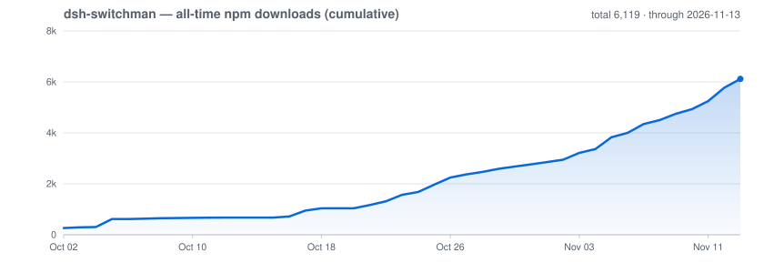

# dsh-switchman

[English](./README.md) | [简体中文](./README.zh.md) | [繁體中文](./README.zh-TW.md) | [日本語](./README.ja.md) | [한국어](./README.ko.md) | [Español](./README.es.md) | **Français** | [Deutsch](./README.de.md) | [Italiano](./README.it.md) | [Português](./README.pt.md) | [Русский](./README.ru.md)

> **La famille switchman**, même auteur, même orchestration : [opencode-switchman](https://github.com/mrzturn/opencode-switchman) (l'original OpenCode) · [zcode-switchman](https://github.com/mrzturn/zcode-switchman) (le portage ZCode) · **dsh-switchman** (ce dépôt, l'édition DeepSeek Harness).


> Le contexte sur un compteur. Les tâches se dispatchent seules.

## Pourquoi en avoir besoin

À force de travailler avec DSH, on finit par se heurter à deux problèmes : la session s'alourdit à mesure que la conversation s'étire — l'historique gonfle le contexte à des centaines de milliers de tokens, le modèle commence à oublier, à ralentir, à coûter cher, et le /compact manuel avale des détails à chaque compression ; et le modèle principal fait tout lui-même — retrouver un fichier, lancer un test, recouper des données, il mâche tout cela seul, lentement et à grands frais, alors que l'essentiel de ce travail gagnerait à être confié à un modèle bien moins cher.

dsh-switchman est un plugin pour [DeepSeek Harness](https://github.com/deepseek-ai/deepseek-harness) (DSH). Une fois installé, le modèle principal passe de « tout faire lui-même » au rôle de répartiteur : mesurer le niveau d'eau, choisir le couloir, distribuer les tâches, contrôler le résultat. Ce n'est pas un nouveau modèle — c'est une doctrine d'orchestration accrochée à DSH, accompagnée d'une page de réglages. Concrètement, il fait huit choses :

**1. Niveau d'eau du contexte : les longues sessions ne débordent jamais.** Chaque tour compte en direct les tokens de la session et les confronte à trois lignes d'eau qui durcissent par paliers : 80k (soft, réglable) rappelle qu'« il est temps de déléguer » ; 95k (hard) resserre le budget de lecture par appel et pousse à conclure ; 150k (force) déclenche la remise automatique — le document de remise est écrit (le journal de session à ajout seul constitue la sauvegarde complète), le contexte compacté, la session réveillée pour continuer, et la tâche ne s'interrompt jamais. Les subagents d'arrière-plan encore en course à cet instant ne sont pas perdus pour autant : leurs id, descriptions de tâche et chemins de rapport sont consignés dans le document de remise, et la session relancée sait où récupérer les rapports au lieu de redéspatcher en double. Chaque subagent dispatché embarque son propre plafond strict ; une fois atteint, il écrit son résumé HANDOFF et se retire. Quand l'intervention automatique ne vous convient pas, reprenez la main à tout moment : `/ctx-pause` arrête toutes les actions de niveau (la mesure continue, la ligne d'eau en direct de la fin passe en paused — il n'agit plus, c'est tout), `/ctx-resume` rétablit à tout moment — après un redémarrage de DSH, l'intervention revient aussi d'elle-même, un lâcher-prise temporaire, pas une extinction définitive ; `/ctx-handover` n'attend pas que le niveau touche le plafond et déclenche à la demande la même remise : écrire le document de remise, compacter le contexte, réveiller la session pour continuer (la session est d'abord conduite jusqu'à la limite d'inactivité, le résultat peut donc prendre quelques minutes).

**2. Six pools de dispatch : le bon modèle pour chaque tâche.** Un pool léger (economy, les petites tâches en série), un pool mécanique (mechanical, les réécritures sur gabarit), un pool principal (main, le code au quotidien), un pool haute difficulté (hard, raisonnement corsé et refontes à grande échelle), un pool multimodal (vision, lire les images) et un pool de relecture (review, vérification indépendante). Dans la page de réglages, vous cochez les candidats, les classez par priorité (avec tiers S/A/B/C en option) et épinglez un effort de raisonnement pour chaque route — le menu déroulant des niveaux reflète ce que ce modèle supporte réellement, pas trois niveaux génériques. Chaque prompt du modèle principal embarque une table de recommandations `[SWITCHMAN:POOLS]`, et le dispatch suit cette table. Le mode d'exécution a trois états : off / advice / enforce (enforce = tout modèle hors pool est refusé sans appel).

**3. Mode Agent Teams : passer du solo à la direction d'une équipe.** Désactivé par défaut — juste après l'installation, on reste sur le dispatch subagent léger. Deux interrupteurs indépendants dans la page de réglages :

- **Mode équipe d'agents** — l'activer injecte la doctrine d'équipe (délégation par défaut + vérification par paliers + discipline du tableau de tâches partagé) et active automatiquement les Agent Teams de DSH : le modèle principal peut recruter des coéquipiers permanents (`spawn_teammate`), confier du travail au tableau de tâches partagé (`team_task_*`) et échanger des messages avec eux. Le moment de constituer une équipe obéit à une discipline explicite : sous-tâches indépendantes parallélisables, gros lots autoportants, contexte principal déjà bien chargé, besoin de séparer les rôles ; les enquêtes ponctuelles restent du ressort du subagent. Refermer l'interrupteur ne laisse aucun résidu des clauses d'équipe, et ne retire jamais les outils d'équipe aux sessions déjà en cours.
- **Synchronisation de la liste blanche des modèles de subagents** — DSH tient une liste d'autorisation « modèles qu'un agent peut choisir pour ses subagents » : une route cochée dans un pool mais jamais autorisée se voit refuser le dispatch quand le modèle principal la désigne nommément (en mode équipe, elle est marquée d'un ⚠). Activez cet interrupteur et l'union des six pools est d'un coup écrite dans cette liste — switchman reste l'unique source de vérité, fini la double configuration. La liste blanche s'applique par instantané à chaque nouvelle session : la synchronisation ne concerne que les sessions ouvertes ensuite.

L'en-tête de session donne un retour immédiat : un badge ⚡ « équipe autonome » et une puce ◇ indiquant le modèle réellement utilisé par la session ; pendant une remise automatique, une bannière en direct annonce « remise en cours · écriture du document de remise / compactage du contexte / réveil de la continuation ».

**4. Préférences de langue : une question posée une fois, retenue pour toujours.** Un menu déroulant chacun pour les réponses, les commentaires de code et la documentation, avec un scope global ou par projet (`.switchman/lang.json`). Ne rien régler est permis — au premier besoin, on vous pose la question une fois dans la langue de votre interface DSH, la réponse est retenue, et chaque session suivante s'y conforme automatiquement.

**5. Langue de l'interface : le plugin parle votre langue aussi.** Tout en haut de la page de réglages, une nouvelle section « Interface » accueille un menu déroulant « Langue de l'interface » (clé de réglage `uiLocale`) : Auto (par défaut — suit la langue de l'appli DeepSeek Harness) ou n'importe quelle langue de l'interface du plugin, toujours affichée par son endonyme, jamais traduite. Elle ne bascule que l'interface du plugin lui-même — le badge d'en-tête, le panneau d'accueil et la page de réglages —, pas la langue de l'appli DSH : l'aperçu est immédiat, sans redémarrage ; l'enregistrement retient le choix ; le prochain démarrage le restaure ; tout échec retombe sur la langue de l'appli ; et tous les dictionnaires voyagent dans le bundle, sans téléchargement.

**6. Vérification par paliers : chaque modification est contrôlée.** Au-delà de 20 lignes modifiées, passage au testeur ; au-delà de 300 lignes, ou dès que l'on touche à la logique cœur / sécurité / cohérence des données, en plus un relecteur indépendant. Le modèle du relecteur est choisi pour éviter celui de « l'agent qui a écrit le diff », autant que les pools le permettent ; quand c'est vraiment impossible, la conclusion le déclare DOWNGRADED. Dites « pas d'équipes » et il repasse aussitôt en solo.

**7. `/vision` : même un modèle purement textuel peut travailler avec des images.** Quand le modèle principal ne sait pas lire les images, DSH refuse les messages avec image dès l'entrée. Collez l'image, tapez `/vision où est l'erreur sur cette image`, et l'image est confiée à un modèle du pool multimodal pour lecture ; les conclusions reviennent dans la session courante. Un avertissement apparaît tôt au-dessus du champ de saisie — « le modèle courant ne sait pas lire les images » ; si un envoi d'image ordinaire est refusé, le brouillon est réécrit une fois en `/vision` et renvoyé tout seul, sans rien retaper ; sans pool multimodal configuré, la commande refuse et donne les indications de configuration.

**8. Routage par intention : le bon modèle se choisit tout seul.** La page de réglages accueille un nouveau groupe « Routage par intention » : un interrupteur général (désactivé par défaut ; l'activer exige un classifieur et au moins un candidat), la route du petit modèle classifieur (provider + model + effort facultatif — les modèles de décision type TypeSafe Jev comme les modèles de conversation génériques conviennent, et la sortie est analysée avec tolérance), un choix du type de classifieur à trois options (auto / decision / chat), une liste de candidats indépendante (chaque candidat : provider + model + effort facultatif + une note de capacité d'une ligne), la fenêtre de cache en secondes (300 par défaut, calée sur les caches de prompt des fournisseurs, environ 5 minutes), le seuil de confiance du basculement (80 par défaut), le timeout de classification (60000 ms par défaut), le nombre de messages d'historique (6 par défaut) et le budget de caractères (2400 par défaut), et un modèle de repli facultatif (avec un pin d'effort facultatif et indépendant ; sans pin, l'effort par défaut du modèle de repli sélectionné s'applique, indépendamment de celui du classifieur). Le sélecteur de modèles gagne une entrée « Auto » dans le groupe « Auto · Switchman » (le client la rend localisée — « Automatique (routage par intention) » en français) ; une fois choisie, chaque message utilisateur passe par le classifieur pour désigner le meilleur candidat, et la décision est verrouillée pour ce tour : si la confiance manque ou que la fenêtre de cache est encore ouverte, le modèle courant reste en place (son cache est réutilisé) ; on ne bascule que lorsque la confiance est suffisante ou que le modèle courant ne fait pas partie des candidats. Le basculement se fait en silence à la couche d'appel — aucun message « modèle changé » n'est inséré dans la session. Au-dessus du champ de saisie figure une pastille d'état (en routage automatique, elle montre le modèle routé courant et la confiance de la dernière décision) ; candidats et seuils restent consultables dans la page de réglages.

Un seul modèle ? Ça vaut quand même l'installation — le contrôle du niveau d'eau et la vérification par paliers se moquent du nombre de modèles, et une longue session mono-modèle en profite tout autant.

## Skills incluses

- **db-query** — vérification MySQL / Redis en lecture seule : exécuter du SQL pour recouper les enregistrements, contrôler les clés de cache / TTL et la cohérence entre stores ; refuse toute écriture. Initialisation au premier usage (voir ci-dessous).
- **git-commit-message** — produit un texte de commit conforme aux conventions. Du texte seulement ; il ne lance jamais git à votre place.
- **requirement-docs** — une spécification unifiée pour l'analyse des besoins / PRD / documents de conception, avec archivage dans `docs/requirements-and-design/`.

## Démarrage rapide

1. **Installer** — depuis n'importe quelle session d'agent, ou depuis la page de gestion des plugins Web :

   ```
   plugin_manager: install_bundle  target=dsh-switchman
   ```

   ou depuis un checkout local (en lien ; après mise à jour, refaire `remove_bundle` + `install_bundle`) :

   ```
   plugin_manager: install_bundle  target=/path/to/dsh-switchman
   ```

   ou depuis un terminal avec la commande `dsh` — choisissez le profil correspondant à votre façon d'exécuter DSH :

   ```bash
   dsh plugin --profile web add dsh-switchman      # Web GUI
   dsh plugin --profile desktop add dsh-switchman   # appli desktop
   ```

2. **Redémarrer DSH** — quittez complètement l'application puis rouvrez-la (recharger la page ne suffit pas) pour que la table des modules client reconnaisse le bundle.

3. **Configurer** — Réglages → dsh-switchman, ou « Centre de contrôle Switchman » dans la barre latérale de la page d'accueil. Tout tient sur une seule page ; la voici — un passage de haut en bas et c'est réglé :

   

   - **Interface** — la langue de l'interface du plugin lui-même. Sur la capture, « Français » est sélectionné : c'est l'aperçu immédiat, toute la page bascule sur-le-champ ; par défaut, « Auto » suit la langue de l'appli DSH. Le choix est retenu à l'enregistrement, et on peut repasser sur « Auto » à tout moment.
   - **Langue** — la langue de ce que produit l'agent. Le scope de la capture est « Global (ce profil) » (possible aussi par projet, chacun lit son `.switchman/lang.json`) ; les trois menus déroulants réponses / commentaires de code / documentation sont tous fixés sur « Français (fr) », chacun suivi d'une ligne d'état « actuel : … ». Tout laisser vide se fait sans douleur : une question posée une fois au premier usage, puis retenue.
   - **Pools de dispatch** — six cartes sur deux rangées de trois : en haut léger / mécanique / principal ; en bas haute difficulté / multimodal / révision. Chaque carte coche les modèles candidats groupés par fournisseur ; cochez « ordre manuel » et elle devient une liste de priorités numérotée, à réordonner avec ↑ ↓ × ; chaque route peut épingler un effort de raisonnement (par défaut « suivre le couloir »). La ligne de résumé en haut se met à jour en direct ; sur la capture : « 4/6 pools configurés · 2 classés · mode advice ».
   - **Classement des capacités + mode d'exécution** — l'union des modèles cochés dans les six pools, classée par capacité, les plus forts devant (sur la capture glm-5.3 ancré S et glm-5.3-flash ancré A) ; on peut réordonner et retirer ; le mode d'exécution va de advice / enforce (enforce = tout modèle hors pool est refusé sans appel).
   - **Équipe d'agents** — les deux interrupteurs, mode équipe et synchronisation de la liste blanche, arrivent désactivés ; sur la capture ils sont activés, avec sous chacun une ligne d'état de synchronisation.
   - **Niveau d'eau du contexte** — les trois seuils (sur la capture 80000 / 120000 / 150000), le budget de lecture par appel (3000), le comportement du palier hard (passage à débit limité / blocage), l'interrupteur de remise automatique et le plafond indépendant des subagents : tout tient dans cette zone. La ligne du bas porte les commandes : `/ctx-pause` suspend les interventions · `/ctx-resume` reprend · `/ctx-handover` écrit le document et remet immédiatement (il conduit la session jusqu'à une limite d'inactivité avant de compacter — le résultat peut prendre quelques minutes).
   - **Routage par intention** — l'interrupteur général, la route du petit modèle classifieur, le type de classifieur (auto / decision / chat), la liste de candidats indépendante (chacun avec sa note de capacité), la fenêtre de cache / seuil de confiance / timeout / budget d'historique et un modèle de repli facultatif. Une fois activé, le sélecteur de modèles gagne l'entrée localisée « Automatique (routage par intention) », et une pastille au-dessus du champ de saisie affiche le modèle routé et la confiance.

4. **Vérifier** — un badge ⚡ « équipe autonome » apparaît dans l'en-tête de session (avec à côté une puce ◇ montrant le modèle de la session en cours) ; ou demandez simplement au modèle « quel est le titre du dernier paragraphe de ton prompt système » — la réponse doit mentionner la doctrine dsh-switchman.

**Initialisation de db-query au premier usage** (les dépendances du script s'installent dans le répertoire du skill — votre projet reste propre) :

```bash
bash <install-dir>/skills/db-query/scripts/setup.sh
```

**Conseils de choix du classificateur :** pour déployer le modèle de décision en local, le plus simple est de servir `d3:4b-mxfp8` avec Ollama : choisissez le type de classificateur « endpoint de décision (systemone) », renseignez l'endpoint avec `http://127.0.0.1:11434/v1/systemone` et indiquez `d3:4b-mxfp8` comme nom de modèle. Avec le classificateur de chat du catalogue LLM, privilégiez un petit modèle cloud, ou un petit modèle local sans capacité de réflexion (raisonnement) : désactiver la réflexion réduit à la fois la latence et le taux d'échecs par timeout de classification.

## Configuration par défaut

Voici l'ensemble complet des valeurs juste après une installation neuve (source faisant foi : le schéma zod de `host/config.js`).

**Interface et langues** : `uiLocale` = `auto` (suit la langue de l'appli DSH) ; `langScope` = `global` ; `langConversation/Comments/Docs` = vides (une question posée une fois à la première session, puis retenue ; la langue des commentaires et de la documentation suit celle de la conversation).

**Pools de dispatch** : les six couloirs (economy/mechanical/main/hard/vision/review) démarrent sans candidats (= les modèles par défaut du système, aucune intervention) ; l'ordre manuel et l'effort épinglé sont désactivés/vides ; `dispatchEnforce` = `advice` (simple recommandation, rien n'est forcé).

**Niveau d'eau du contexte** : soft `80000` / hard `95000` / force `150000` tokens ; budget de lecture par appel `3000` ; comportement en cas de dépassement `cap` (tronquer avec avertissement) ; `wmAutoHandover` = activé (à force, écriture du document de remise + compactage automatiques) ; le plafond strict des subagents = activé (150k partagées).

**Agent Teams** : `teamsMode` = désactivé ; `syncWhitelist` = désactivé (les deux interrupteurs sont indépendants l'un de l'autre).

**Routage par intention** (indisponible par défaut ; il exige un classifieur + au moins un candidat + l'interrupteur général) : `intentEnabled` = désactivé (désactivé, l'entrée Auto reste cachée et les sessions déjà passées en Auto empruntent la chaîne de repli) ; route du classifieur non définie ; type de classifieur `chat` ; liste de candidats vide (les catégories préinstallées ne participent au routage qu'une fois un modèle renseigné) ; fenêtre de cache `300` s / seuil de confiance du basculement `80` / timeout de classification `60000` ms ; historique de `6` messages / `2400` caractères ; `intentContextWindow` = `200000`.

**Trim de contexte** : `trimEnabled` = activé ; `trimMode` = `auto` (entièrement automatique) ; porte de croissance `22500` + incrément `25000` tokens ; pression `65%` / urgence `95%` ; rappels advisory `65%` / `95%` ; queue protégée `10` messages ; plafond de cadence des folds `30` par heure ; modèle annexe non défini (hérite du modèle de la session) — détails dans la section « Trim automatique du contexte » ci-dessous.

**À savoir dès l'installation** : ① l'indisponibilité du routage par intention en sortie d'usine est un choix délibéré — trois étapes pour l'activer (classifieur, candidats, interrupteur) ; ② la fenêtre effective d'Auto vaut 200000 dès l'usine — le garde-fou garantit 0.8×fenêtre ≥ force (150000), si bien que la ligne de compactage cœur (160000) se situe toujours après la ligne de remise en douceur (150000) ; ③ l'effet le plus tangible dès l'usine est le trio de niveaux : 80k rappelle de déléguer / 95k resserre la lecture / 150k remet automatiquement (document + compactage) — sans aucun réglage.

## Trim automatique du contexte

Les longues sessions restent bon marché : les plages de conversation consommées sont repliées en résumés déterministes compacts — entièrement automatiquement, sans casser le cache de prompts du fournisseur. À une frontière d'inactivité, le moteur de trim (`host/context-trim/`) choisit les plages qui valent un repli, un modèle annexe écrit le résumé (sous pression d'urgence seulement, c'est un fold mécanique sans appel de modèle annexe), et le fold est validé dans l'état de folds de la session. Dès lors, chaque requête sortante est reconstruite depuis cet état — des blocs de résumé remplacent les plages repliées, la queue vive reste intacte. La session stockée n'est jamais réécrite, et rien ne se passe en plein stream.

Niveaux d'automatisation (`trimMode`) :

- **`off`** — mesure seule : l'échantillonnage de l'usage et des hits de cache tourne toujours ; pas de bannière, pas de folds.
- **`advisory`** — le modèle de session se replie lui-même : les outils `ctx_trim_fold` et `ctx_trim_status` plus l’en-tête de protocole sont exposés. Quand la pression de session atteint `trimAdvisoryPercent` de la fenêtre effective, le moteur ajoute un rappel de repli épinglé sous forme de suffixe `user/message` à la fin de la surface de session active (pas à l’en-tête system du dispatch) — répété immédiatement au passage au niveau critique et supprimé dès que la pression repasse sous la ligne.
- **`auto`** (par défaut) — tout ce qui précède, plus des folds automatiques à la frontière d'inactivité, en trois paliers : une porte de croissance (croissance > `trimGrowthTokens` mesurée depuis le point bas après le dernier pli — l'ancre qui garde la porte armée après des plis confirmés à des points hauts de la view — ET un incrément compressible contigu ≥ `trimIncrementTokens`), un palier de pression (`trimPressurePercent` de la fenêtre de contexte) et un palier d'urgence (`trimEmergencyPercent` — un fold mécanique avec son propre refroidissement).

Toutes les clés vivent dans Réglages → dsh-switchman ; les valeurs par défaut viennent de `host/config.js` :

| Clé | Par défaut | Signification |
| --- | --- | --- |
| `trimEnabled` | `true` | Interrupteur maître. Désactivé, folding et métriques s'arrêtent totalement (le listener se dégrade en simple passage). |
| `trimMode` | `auto` | `off` mesure seule / `advisory` folds pilotés par le modèle / `auto` folds pilotés par le système. |
| `trimGrowthTokens` | `22500` | Porte de croissance : on plie quand la view sortante a grandi d'autant depuis le dernier fold. |
| `trimIncrementTokens` | `25000` | Compagnon de la porte : l'incrément compressible contigu doit aussi atteindre cette taille. |
| `trimPressurePercent` | `65` | Palier de pression : on plie quand l'usage de la view atteint ce pourcentage de la fenêtre de contexte. |
| `trimEmergencyPercent` | `95` | Palier d'urgence : fold mécanique forcé (sans appel de modèle annexe) à ce pourcentage. |
| `trimAdvisoryPercent` | `65` | Ligne de rappel advisory : à ce pourcentage de la fenêtre effective, le moteur invite le modèle à replier immédiatement via `ctx_trim_fold` (mode advisory uniquement). |
| `trimAdvisoryCriticalPercent` | `95` | Ligne critique : l'atteindre répète le rappel immédiatement, en contournant le bridage de 10 minutes à palier égal. |
| `trimWindowTokens` | `0` | Plafond de fenêtre effectif pour le calcul des paliers : calculé sur min(fenêtre du modèle, plafond). `0` = suit `wmForceTokens`. |
| `trimProtectedTail` | `10` | Les N derniers messages ne sont jamais repliés. |
| `trimMaxFoldsPerHour` | `30` | Plafond de cadence des folds par heure glissante pour le modèle annexe (les folds d'urgence en sont exemptés). |
| `trimSideModel` | non définie | Route du modèle annexe qui écrit les résumés. Vide = suivre le provider/model de la session, sans hériter de l'effort de cet appel ; les distillations ladder utilisent aussi cette route. L'effort du résumé peut être fixé séparément ; sans pin, les métadonnées du modèle déterminent le niveau de reasoning activé le plus bas ; pour un modèle limité à un interrupteur on/off, choisir off. Si le reasoning n'est pas pris en charge ou si les métadonnées sont indisponibles, aucun effort n'est envoyé et le comportement par défaut du modèle/de l'adaptateur s'applique. |
| `trimFoldFallbackModel` | non définie | Route de relance quand le modèle annexe de résumé échoue ; un fold de pression dégrade alors en mécanique. Vide = pas de repli. Le modèle de repli du fold choisi manuellement a un pin d'effort indépendant ; sans pin, appliquer la même recommandation par métadonnées que pour le modèle de résumé, et en l'absence de métadonnées, le défaut du modèle. Choisir une route avec de la marge sur cooldowns, contrôle de risque et concurrence. |
| `trimStateDir` | non défini | Redéfinit le répertoire d'état des folds. Vide = `<dshHome>/.dsh-switchman/state/trim/`. |
| `surfaceFold` | `true` | Expédie les folds validés sur la surface de session (paire d'événements : mesure shadow-price + remplacement `surfaceOp`). Désactivé, la vue reste en splice seul. |

**Chemins de déclenchement.** Les vérifications de paliers s'exécutent à la frontière d'inactivité et, en repli pour les hôtes où les événements d'état d'inactivité sont inaccessibles, après chaque fin de flux du modèle (limitées à une évaluation par 60 s et par session). Chaque décision — folds comme no-ops — est ajoutée comme une ligne `key=value` horodatée à `decisions.log` dans le répertoire d'état des folds (voir `trimStateDir`), donnant aux folds une piste d'audit hors ligne; le vocabulaire des lignes (`view-applied`, lignes de décision/résultat de fold, `surface-replace`, `surface-replace skipped reason=…`) est catalogué dans [docs/context-trim.md](./docs/context-trim.md).

**Vérité du fil et régime stationnaire.** Les lignes de décision portent `view=<n>` et, une fois qu'une réponse est arrivée, `wire=<n>` — le prompt réel du fournisseur (entrée non cachée + lecture de cache + écriture de cache, échantillonné depuis l'événement d'usage du stream). L'estimation de la view ne compte que le tableau de messages et lit toujours moins que le fil, du surcoût fixe (mesuré ≈ 17.3k : system prompt + schémas d'outils + persona), donc les paliers de pression et d'urgence évaluent sur `max(view, wire)`, et seul `wire` est une lecture de la taille du prompt. Sur une fenêtre de 150k, la dent de scie saine fait tourner le fil à ≈ 40k juste après un fold ↔ 64–97.5k au suivant (≈27%–65% de la fenêtre), un fold par ~25k de croissance brute, le plafond étant arrimé près de 97.5k par le palier de pression plutôt que par la fenêtre. Si `view` monte sans qu'aucune ligne `surface-replace` n'apparaisse jamais, lisez les lignes d'omission (`incomplete-seqs`, `no-service`, `compaction-lock`).

**Époques de compactage de l'hôte.** Les références de fold sont ancrées dans les identifiants de messages et les hachages de contenu ; quand l'hôte compacte lui-même l'historique renvoyé, tout le registre vieillit d'un coup : plus aucun bloc ne se localise, la vue retombe silencieusement sur l'historique brut (fail-open — le journal des décisions note `view-applied applied=0`), et le plugin ré-ancre sa base de croissance sur la vue post-compaction à la requête suivante. La compaction de l'hôte est donc la couche de rognage de dernier recours ; les folds du plugin font le travail fin au sein d'une époque de l'hôte. Certains dispatches remettent des tableaux de requête ou des objets d'options entièrement gelés (la boucle d'agent actuelle gèle en profondeur les requêtes assemblées) ; pour eux, `injectView` rapporte l'issue dans le journal des décisions : `nothing-to-apply` (aucun bloc de fold localisé — l'historique brut EST la vue), `in-place`/`swapped` (la vue pliée est partie avec la requête) ou `none` (un fold existait mais le dispatch gelé ne pouvait pas le transporter — l'historique brut part sur le fil). **Le remplacement de surface est le chemin d'expédition quand il est disponible** (`surfaceFold`, activé par défaut) : à la frontière sérielle `agent/turn-stopping` plus un balayage d'inactivité, le plugin ajoute l'événement de mesure shadow-price à la manière de l'hôte et UN remplacement `user/message` portant `surfaceOp {op:'replace', startSeq, endSeq}` avec des `sourceEventSeqs` couvrant chaque nœud de surface masqué — le même mécanisme que celui de la compaction de l'hôte elle-même —, de sorte qu'un fold validé rejoint le fil depuis le niveau source, dispatches gelés compris. Tant que les dispatches récents d'une session consignent `none`, le plugin traite la vue comme une simple mesure : le niveau d'eau lit à la place le total rapporté par le fournisseur (le palier force et la remise automatique continuent de fonctionner), les cycles de fold se mettent en pause au lieu de brûler des appels au résumeur, et la bannière de rognage marque la ligne avec `wire=raw` (folds not shipping; watermark reads the tally) ; les hôtes sans le mécanisme de surface (ou avec l'option désactivée) gardent exactement cet ancien comportement.

**Comment les folds préservent les hits de cache.** Chaque fold repaye le préfixe une fois ; l'objectif est le coût amorti, pas un taux de hits parfait. Le moteur fait respecter le contrat de cache : les folds sont en ajout seul — la frontier n'avance que vers l'avant et la zone gelée n'est plus jamais éditée ; la view est reconstruite de façon déterministe depuis (historique, état des folds), donc le préfixe sérialisé reste identique à l'octet entre les folds et le cache du fournisseur continue de toucher ; les frontières de fold ne séparent jamais un tool-call d'assistant de son résultat ; les `trimProtectedTail` derniers messages sont exemptés ; et tout échoue ouvert — une erreur interne se dégrade en passage à travers, jamais en requête cassée.

**Arbitrage du compactage.** Deux mécanismes de trim automatiques sur un même historique résumeraient tout deux fois et détruiraient mutuellement leur frontier, donc `cordis.patch.yml` met `auto: false` sur les lignes `dsh-compaction-basic` de l'hôte : context-trim devient l'unique trimmer sémantique. Le `/compact` manuel continue de marcher, et la remise du palier force (qui emprunte justement ce chemin manuel) reste intacte. La récupération de débordement passe au trim : la tentative au-dessus de la fenêtre échoue une fois, puis le palier d'urgence plie la view pour que la tentative suivante tienne.

**Héritage des forks.** Une session forkée (fork de sous-agent) hérite de l'état de folds du parent par copie-au-fork — mais seulement si l'état parent existe et si l'historique de l'enfant résout réellement la frontier du parent ; sinon l'enfant démarre propre. Un héritage par enfant, idempotent entre redémarrages.

**La bannière de niveaux lit la view.** La bannière de niveaux rapporte le nombre de tokens de la view sortante (ce que le modèle voit réellement après repli) au lieu du décompte stocké — une session fortement repliée n'épingle donc plus le niveau d'eau au palier hard.

## Fonctionnement

- La partie Host (`index.js` + `host/`) injecte les sections stables à l'octet près du prompt système (langue / couloirs / protocole de niveau d'eau / équipes) plus la ligne d'eau en direct via l'instantané de runtime-context de fin (un canal qui ajoute au lieu de réécrire la tête du prompt, si bien que le cache de prompt du fournisseur reste intact), ainsi que les deux verrous budget de lecture et enforce, et les quatre commandes slash (le trio ctx + `/vision`). Tout réglage enregistré prend effet au prochain assemblage de prompt — sans redémarrage.
- La partie Client (`client.js`) rend la page de réglages, le badge ⚡ et la puce ◇ du modèle dans l'en-tête de session, ainsi que la bannière dynamique « remise en cours » ; les instantanés de configuration se lisent et s'écrivent via la famille de routes Host.
- L'entrée « Centre de contrôle Switchman » dans la barre latérale de la page d'accueil ouvre en un clic, sous forme de panneau central, cette même page de configuration ; l'entrée de réglages d'origine reste en place.
- `cordis.patch.yml` reprend intégralement la liste de plugins des presets d'usine et n'étend que le persona suffix ; les outils Agent Teams eux-mêmes viennent du bundle d'usine et s'activent automatiquement quand le mode équipe est allumé.

## Maintenance

- Si une mise à niveau de DSH change la liste de plugins des presets d'usine, resynchronisez `cordis.patch.yml` depuis les nouveaux `presets/*.patch.yml` (conservez le doctrine suffix et l'arbitrage du compactage — `auto: false` sur les lignes `compaction-basic`), puis réinstallez.
- Les lignes de protocole (`[SWITCHMAN:LANG|POOLS|WATERMARK|TEAMS]`) restent volontairement en anglais et stables à l'octet — ne les localisez pas.
- `npm pack --dry-run` doit conserver la forme auditée de 60 fichiers / ~380 kB (~1,26 Mo décompressés ; `docs/` est exclu).

## Téléchargements

Tous les téléchargements npm depuis la première publication, en cumul — tracés à partir de l'[API officielle des téléchargements npm](https://api.npmjs.org/) et actualisés chaque jour par GitHub Actions ([script du graphique](scripts/downloads-chart.mjs)) :



## License

MIT
