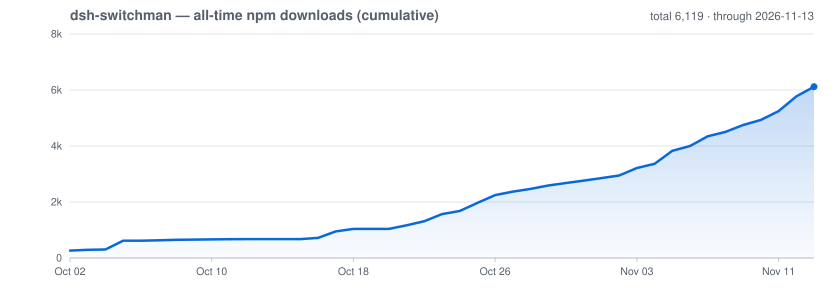

# dsh-switchman

[English](./README.md) | [简体中文](./README.zh.md) | [繁體中文](./README.zh-TW.md) | [日本語](./README.ja.md) | [한국어](./README.ko.md) | [Español](./README.es.md) | [Français](./README.fr.md) | [Deutsch](./README.de.md) | **Italiano** | [Português](./README.pt.md) | [Русский](./README.ru.md)

> **La famiglia switchman**, stesso autore, stessa orchestrazione: [opencode-switchman](https://github.com/mrzturn/opencode-switchman) (l'originale per OpenCode) · [zcode-switchman](https://github.com/mrzturn/zcode-switchman) (il port per ZCode) · **dsh-switchman** (questo repository, l'edizione DeepSeek Harness).


> Contesto al contatore: ogni task trova da sé la corsia giusta.

## Perché serve

Se lavori con DSH, col passare del tempo ti imbatti in due cose: la sessione pesa sempre di più — la cronologia gonfia il contesto fino a centinaia di migliaia di token, il modello inizia a dimenticare, rallenta e costa di più, e il /compact manuale comprime perdendo dettagli nel farlo; e il modello principale fa tutto da solo — leggere un file, lanciare un test, confrontare dati: è sempre lui a masticarli, lento e costoso, quando gran parte di quel lavoro spetterebbe a un modello economico.

dsh-switchman è un plugin per [DeepSeek Harness](https://github.com/deepseek-ai/deepseek-harness) (DSH). Una volta installato, il modello principale continua a lavorare di persona — solo con più criterio: sceglie le sue battaglie, affida i lavoretti a corsie economiche e lascia che l'instradamento per intent faccia atterrare l'urgente o il difficile sul modello giusto, riservando a sé solo ciò che merita davvero un tocco personale; scarta il gonfio e distilla l'essenziale — le parti già digerite della conversazione si ripiegano in riassunti compatti mentre il livello dell'acqua misura ogni spesa, e il contesto viaggia sempre leggero; e quando il carico supera un solo paio di mani, arruola compagni permanenti che si spartiscono il lavoro su un task board condiviso, mentre lui si riserva il dispatch e la verifica. Non è un nuovo modello: è un regolamento di orchestrazione agganciato a DSH più un'interfaccia di configurazione. In concreto fa nove cose:

**1. Trim automatico del contesto: la sessione si allunga, il costo resta piatto.** Un `/compact` manuale ti fa aspettare, perde dettagli e buca la cache di prompt del fornitore. Il motore di trim automatizza tutto questo: le parti già digerite della conversazione vengono ripiegate in riassunti deterministici e compatti ai confini di inattività (a scriverli pensa un side model; sotto pressione d'emergenza il ripiegamento è meccanico, senza chiamate al modello), e da quel momento ogni richiesta in uscita viene ricostruita dallo stato dei ripiegamenti — i blocchi di riassunto prendono il posto delle parti ripiegate, la coda viva resta parola per parola. Il log di sessione salvato non viene mai riscritto, e nulla tocca lo stream in pieno corso. I ripiegamenti sono solo append e la ricostruzione è deterministica: il prefisso serializzato resta identico al byte tra un ripiegamento e l'altro e la cache del fornitore continua a essere agganciata; ogni fallimento interno ricade in fail-open verso il passaggio trasparente — mai una richiesta malformata. Tre livelli completamente automatici (crescita / pressione / emergenza), più una modalità advisory in cui è il modello a ripiegare da solo — la meccanica è in fondo, nella sezione «Trim automatico del contesto».

**2. Livello dell'acqua del contesto: le sessioni lunghe non esplodono.** A ogni turno conta i token della sessione in tempo reale, e tre soglie inaspriscono a gradini: 80k (soft, regolabile) ricorda che «è ora di delegare»; 95k (hard) stringe il budget di lettura per singola chiamata e spinge verso la chiusura; 150k (force) avvia l'handover automatico — scrittura del documento di handover (il log di sessione append-only è la copia completa), contesto compattato, sessione risvegliata per continuare: il task non si interrompe. Nemmeno i subagent in background ancora in corsa al momento del passaggio si perdono: id, descrizione del task e percorso del report finiscono nel documento di handover, così la sessione ripresa sa dove raccogliere i report invece di ri-assegnare lo stesso lavoro; ogni subagent inviato porta inoltre con sé un tetto massimo indipendente e, raggiunto il limite, esce dopo aver scritto il riepilogo HANDOFF. Il livello legge la vista dopo il trim — ciò che il modello vede davvero —, così una sessione molto ripiegata non resta più inchiodata sulle soglie alte. Se l'automatismo non ti torna: `/ctx-pause` ferma tutte le azioni (la misurazione continua), `/ctx-resume` ripristina in qualsiasi momento — e dopo un riavvio torna anche da solo; `/ctx-handover` avvia su richiesta lo stesso handover, senza aspettare il tetto.

**3. Instradamento per intent: arriva il messaggio, il modello prende il suo posto.** Scegli «Auto (instradamento per intent)» per la sessione e ogni messaggio dell'utente viene prima tipizzato da un piccolo modello classificatore, che lo fa atterrare sul candidato più adatto — ogni candidato porta una nota di capacità di una riga a orientare la scelta. La decisione è bloccata per il turno: se la fiducia manca o la finestra di cache è ancora aperta, resta il modello corrente (la sua cache di prompt continua a rendere); si passa solo quando la fiducia è bastevole o il modello corrente non è tra i candidati. Il passaggio avviene in silenzio al livello di chiamata — nessun rumore di «modello cambiato» nella sessione — mentre un chip sopra la casella di input mostra in diretta rotta e fiducia. Come classificatore valgono sia i piccoli modelli di decisione sia i modelli di chat generici; candidati, soglie e finestra di cache sono sempre a una pagina di impostazioni di distanza.

**4. Modalità Agent Teams: dal lavoro solitario alla squadra.** Disattivata di default: appena installato si lavora con un dispatch leggero via subagent. Nella pagina delle impostazioni, due interruttori indipendenti: **Modalità Agent Teams** — una volta attivata, inietta la dottrina di squadra (delega per default + verifica a livelli + disciplina del task board condiviso) e abilita automaticamente gli Agent Teams di DSH: il modello principale può arruolare compagni permanenti (`spawn_teammate`), assegnare lavori al task board condiviso (`team_task_*`) e scambiarsi messaggi con loro. Quando formare la squadra segue una disciplina precisa: sotto-task indipendenti parallelizzabili, lavori voluminosi e autosufficienti, livello dell'acqua del contesto principale già alto, necessità di separare i ruoli; le indagini una-tantum restano al subagent. Ri-spegnendo l'interruttore, le clausole di squadra spariscono senza residui, e gli strumenti di squadra nelle sessioni in corso non vengono ritirati. **Sincronizzazione della whitelist dei modelli per i subagent** — DSH ha una whitelist di autorizzazione «Consenti agli agenti di scegliere i modelli per i subagent»: le route scelte nei pool ma non autorizzate vengono rifiutate se il modello principale le nomina esplicitamente (in modalità squadra, vengono marcate con ⚠). Con questo interruttore attivo, l'unione dei sei pool viene scritta in un colpo solo in quella whitelist — niente configurazione doppia: switchman è l'unica fonte di verità. La whitelist scatta come snapshot alla «nuova sessione»: la sincronizzazione vale solo per le sessioni aperte dopo.

**5. Sei pool di dispatch: a ogni lavoro il suo modello.** Pool leggero (economy, piccoli lavori in serie), pool meccanico (mechanical, riscritture modellate), pool principale (main, coding di tutti i giorni), pool ad alta difficoltà (hard, ragionamento complesso e refactoring su larga scala), pool multimodale (vision, lettura delle immagini), pool di revisione (review, verifica indipendente). Nella pagina delle impostazioni spunti i candidati, ordini le priorità (con fasce opzionali S/A/B/C) e fichi un reasoning effort per ogni route — il menu a tendina elenca i livelli che quel modello supporta davvero, non tre livelli generici. A ogni turno il prompt del modello principale viaggia con una tabella di raccomandazioni `[SWITCHMAN:POOLS]`: si assegna il lavoro seguendo la tabella. La modalità di esecuzione ha tre stati: off / advice / enforce (enforce = i modelli fuori pool vengono rifiutati sul posto).

**6. Preferenze linguistiche: chiede una volta, ricorda per sempre.** Un menu a tendina per ciascuna delle tre lingue — risposte, commenti nel codice, documenti — con ambito a scelta globale o per progetto (`.switchman/lang.json`). Puoi anche non impostarlo: al primo utilizzo ti viene chiesto una volta, nella lingua dell'interfaccia DSH, e da lì in poi ogni sessione lo rispetta da sé.

**7. Lingua dell'interfaccia: il plugin parla anche la tua lingua.** In cima alla pagina delle impostazioni arriva una nuova sezione «Interfaccia» con un menu a tendina «Lingua dell'interfaccia» (chiave di impostazione `uiLocale`): Automatico (predefinito — segue la lingua dell'app DeepSeek Harness) o una qualsiasi delle lingue dell'interfaccia del plugin, sempre mostrata con il suo endonimo, mai tradotta. Cambia solo l'interfaccia del plugin stesso — il badge nell'intestazione, il pannello home e la pagina delle impostazioni —, non la lingua dell'app DSH: l'anteprima è immediata, senza riavvio; il salvataggio ricorda la scelta; il prossimo avvio la ripristina; ogni errore ricade sulla lingua dell'app; e tutti i dizionari viaggiano nel bundle, nessun download.

**8. Verifica a livelli: finita la modifica, si controlla.** Le modifiche oltre 20 righe vanno a un tester per la verifica; oltre 300 righe, o quando si toccano logica centrale / sicurezza / coerenza dei dati, subentra anche un reviewer con revisione indipendente. Il modello del reviewer si sceglie ancorandolo a quello dell'«agente che ha scritto il diff», evitandolo per quanto possibile; se nel pool proprio non si riesce, la conclusione dichiara DOWNGRADED. Basta dire «non usare le squadre» e torna subito a lavorare da solo.

**9. `/vision`: anche i modelli solo testo trattano le immagini.** Quando il modello principale non sa leggere le immagini, DSH rifiuta al varco i messaggi che le contengono. Alleghi l'immagine e digiti `/vision dov'è l'errore in questa immagine`: l'immagine viene affidata alla lettura di un modello del pool multimodale, e la conclusione torna nella sessione corrente. Sopra la casella di input compare in anticipo l'avviso «il modello corrente non supporta la lettura delle immagini»; se un invio diretto dell'immagine viene rifiutato, il messaggio viene riscritto una volta in `/vision` e reinviato da solo, senza dover rifare tutto a mano; senza pool multimodale configurato, il comando rifiuta e indica come configurarlo.

Un solo modello? Vale comunque la pena installarlo — trim automatico, controllo del livello dell'acqua e verifica a livelli non guardano a quanti modelli hai, e ne giovancono allo stesso modo le sessioni lunghe con un modello unico. L'instradamento per intent ha senso solo con più candidati modello: lascialo spento finché la squadra non si allarga.

## Skill incluse

- **db-query** — verifica in sola lettura su MySQL/Redis: esegui SQL per controllare record, chiavi di cache / TTL, coerenza tra store. Rifiuta ogni scrittura. Inizializzazione al primo uso (vedi sotto).
- **git-commit-message** — testo di commit conforme alle convenzioni. Solo testo; non tocca mai git.
- **requirement-docs** — un'unica specifica per requisiti / PRD / documenti di design, archiviata in `docs/requirements-and-design/`.

## Avvio rapido

1. **Installa** — da qualsiasi sessione agent, o dal gestore plugin Web:

   ```
   plugin_manager: install_bundle  target=dsh-switchman
   ```

   oppure da un checkout locale (link; riesegui `remove_bundle` + `install_bundle` dopo aver fatto pull delle modifiche):

   ```
   plugin_manager: install_bundle  target=/path/to/dsh-switchman
   ```

   oppure da un terminale tramite la CLI `dsh` — scegli il profilo che corrisponde a come esegui DSH:

   ```bash
   dsh plugin --profile web add dsh-switchman      # Web GUI
   dsh plugin --profile desktop add dsh-switchman   # app desktop
   ```

2. **Riavvia DSH** — chiudi completamente l'app e riaprila (ricaricare la pagina non basta), così la tabella dei moduli client rileva il bundle.

3. **Configura** — Impostazioni → dsh-switchman, oppure la voce «Switchman Control Center» nella barra laterale della home. La configurazione sta tutta in una pagina; eccola — un giro dall'alto in basso e hai finito:

   

   - **Interfaccia** — la lingua dell'interfaccia del plugin stesso. Nella schermata è selezionato «Italiano»: è l'anteprima immediata, l'intera pagina cambia all'istante; per predefinito c'è «Automatico», che segue la lingua dell'app DSH. La scelta viene ricordata al salvataggio, e puoi tornare a «Automatico» quando vuoi.
   - **Lingua** — la lingua di ciò che produce l'agente. L'ambito nella schermata è «Globale (questo profilo)» (si può anche per progetto, ognuno legge il proprio `.switchman/lang.json`); i tre menu a tendina risposte / commenti nel codice / documenti sono tutti fissati su «Italiano (it)», ciascuno con la riga di stato «Attuale: …» sotto. Puoi anche non impostarli: al primo uso viene chiesto una volta e ricordato.
   - **Pool di dispatch** — sei schede su due righe da tre: in alto leggero / meccanico / principale; in basso alta difficoltà / multimodale / revisione. In ogni scheda si spuntano i candidati raggruppati per provider; spunta «ordine manuale» e diventa una lista di priorità numerata da riordinare con ↑ ↓ ×; accanto a ogni route puoi fichare il reasoning effort (predefinito «segui la corsia»). La riga di riepilogo in alto si aggiorna in tempo reale; nella schermata: «4/6 pool configurati · 2 in classifica · modalità advice».
   - **Classifica di capacità + modalità di esecuzione** — l'unione dei modelli scelti nei sei pool, ordinata per capacità con i più forti davanti (nella schermata glm-5.3 ancorato in S e glm-5.3-flash ancorato in A); si può riordinare e ridurre; la modalità di esecuzione va da advice / enforce (enforce = i modelli fuori pool vengono rifiutati sul posto).
   - **Squadra di agenti** — i due interruttori, modalità squadra e sincronizzazione della whitelist, partono spenti; nella schermata sono accesi, con sotto una riga di stato della sincronizzazione.
   - **Livello dell'acqua del contesto** — le tre soglie (nella schermata 80000 / 120000 / 150000), il budget di lettura per singola chiamata (3000), il comportamento della soglia hard (passa con limitazione / blocca), l'interruttore dell'handover automatico e il tetto indipendente dei subagent: tutto in quest'area. Una riga di comandi in fondo: `/ctx-pause` sospende gli interventi · `/ctx-resume` li riprende · `/ctx-handover` scrive il documento e passa le consegne subito (guida la sessione fino al confine di inattività prima di compattare: il risultato può richiedere alcuni minuti).
   - **Instradamento per intent** — l'interruttore principale, la route del piccolo modello classificatore, il tipo di classificatore (auto / decision / chat), la lista di candidati indipendente (ciascuno con la sua nota di capacità), finestra di cache / soglia di confidenza / timeout / budget di cronologia e un modello di fallback facoltativo. Attivandolo, il selettore dei modelli guadagna la voce localizzata «Automatico (instradamento per intent)» e sopra la casella di input compare la chip con il modello di instradamento e la confidenza.

4. **Verifica** — nell'intestazione della sessione compare il badge ⚡ «Squadra autonoma» (accanto, il ◇ mostra il modello della sessione in corso); oppure chiedi direttamente al modello «qual è il titolo dell'ultima sezione del tuo system prompt?» — la risposta dovrebbe menzionare la dottrina dsh-switchman.

**Inizializzazione di db-query al primo uso** (le dipendenze degli script vivono nella directory della skill, senza sporcare il progetto):

```bash
bash <install-dir>/skills/db-query/scripts/setup.sh
```

**Consigli sulla scelta del classificatore:** per far girare il modello di decisione in locale, la scelta consigliata è servire `d3:4b-mxfp8` con Ollama: imposta il tipo di classificatore su «endpoint di decisione (systemone)», compila l'endpoint con `http://127.0.0.1:11434/v1/systemone` e indica `d3:4b-mxfp8` come nome del modello. Con il classificatore di chat del catalogo LLM, meglio un piccolo modello cloud, o un piccolo modello locale senza capacità di pensiero (ragionamento): disattivare il pensiero riduce insieme la latenza e il tasso di fallimenti per timeout di classificazione.

## Configurazione predefinita

Questi sono tutti i valori così come si presentano dopo una nuova installazione (fonte autorevole: lo schema zod in `host/config.js`).

**Interfaccia e lingue**: `uiLocale` = `auto` (segue la lingua dell'app DSH); `langScope` = `global`; `langConversation/Comments/Docs` = vuote (una domanda fatta una volta alla prima sessione, poi ricordata; la lingua di commenti e documenti segue quella della conversazione).

**Pool di dispatch**: le sei corsie (economy/mechanical/main/hard/vision/review) partono senza candidati (= i modelli predefiniti del sistema, nessuna interferenza); ordine manuale ed effort fissato spenti/vuoti; `dispatchEnforce` = `advice` (solo consiglio, niente di imposto).

**Livello dell'acqua del contesto**: soft `80000` / hard `95000` / force `150000` token; budget di lettura per singola chiamata `3000`; comportamento oltre budget `cap` (tronca con avviso); `wmAutoHandover` = attivo (a force, scrittura del documento di handover + compattazione automatiche); il tetto massimo dei subagent = attivo (150k condivisi).

**Agent Teams**: `teamsMode` = spento; `syncWhitelist` = spento (i due interruttori sono indipendenti tra loro).

**Instradamento per intent** (non disponibile per predefinito; servono classificatore + almeno un candidato + l'interruttore principale): `intentEnabled` = spento (spento, la voce Auto resta nascosta e le sessioni che l'avevano già scelta percorrono la catena di fallback); route del classificatore non impostata; tipo di classificatore `chat`; lista dei candidati vuota (le categorie preinstallate entrano nell'instradamento solo con un modello assegnato); finestra di cache `300` s / soglia di confidenza del cambio `80` / timeout di classificazione `60000` ms; cronologia di `6` messaggi / `2400` caratteri; `intentContextWindow` = `200000`.

**Trim del contesto**: `trimEnabled` = acceso; `trimMode` = `auto` (del tutto automatico); cancello di crescita `22500` + incremento `25000` token; pressione `65%` / emergenza `95%`; avvisi advisory `65%` / `95%`; coda protetta `10` messaggi; tetto di cadenza dei fold `30` all'ora; modello secondario non impostato (eredita il modello della sessione) — dettagli nella sezione «Trim automatico del contesto» più sotto.

**Note di serie**: ① l'instradamento per intent non disponibile di serie è una scelta voluta — tre passi per attivarlo (classificatore, candidati, interruttore); ② la finestra effettiva di Auto vale di serie 200000 — la barriera di sicurezza garantisce 0.8×finestra ≥ force (150000), così la linea di compattazione del cuore (160000) resta sempre dopo la linea di consegna morbida (150000); ③ di serie la cosa più percettibile è il terzetto di soglie: 80k ricorda di delegare / 95k stringe la lettura / 150k consegna da sola (documento + compattazione) — senza alcuna impostazione.

## Trim automatico del contesto

Le sessioni lunghe restano economiche: le porzioni di conversazione già consumate vengono ripiegate in riassunti deterministici compatti — in modo del tutto automatico e senza rompere la cache dei prompt del fornitore. A un confine di inattività, il motore di trim (`host/context-trim/`) sceglie le porzioni che valgono un fold, un modello secondario scrive il riassunto (solo sotto pressione di emergenza si ricorre a un fold meccanico senza chiamata al modello secondario) e il fold viene registrato nello stato dei fold della sessione. Da lì in poi ogni richiesta in uscita viene ricostruita da quello stato — i blocchi di riassunto sostituiscono le porzioni ripiegate, la coda viva resta intatta. La sessione memorizzata non viene mai riscritta, e nulla accade a metà stream.

Livelli di automazione (`trimMode`):

- **`off`** — solo misura: il campionamento di uso e hit di cache continua; niente banner, niente fold.
- **`advisory`** — il modello della sessione si ripiega da sé: vengono esposti gli strumenti `ctx_trim_fold` e `ctx_trim_status` più l’intestazione di protocollo. Quando la pressione della sessione raggiunge `trimAdvisoryPercent` della finestra effettiva, il motore aggiunge un sollecito di ripiegamento fissato come suffisso `user/message` alla fine della surface attiva della sessione (non all’intestazione system del dispatch) — ripetuto immediatamente all’escalation a critical e rimosso quando la pressione rientra sotto la linea.
- **`auto`** (predefinito) — tutto quanto sopra più fold automatici al confine di inattività, su tre scalini: un cancello di crescita (crescita > `trimGrowthTokens` misurata dal minimo post-ripiegamento dell'ultimo fold — l'ancora che mantiene il cancello armato dopo ripiegamenti confermati su punti alti della view — E un incremento comprimibile contiguo ≥ `trimIncrementTokens`), uno scalino di pressione (`trimPressurePercent` della finestra di contesto) e uno scalino di emergenza (`trimEmergencyPercent` — un fold meccanico con il proprio raffreddamento).

Tutte le chiavi stanno in Impostazioni → dsh-switchman; i valori predefiniti vengono da `host/config.js`:

| Chiave | Predefinito | Significato |
| --- | --- | --- |
| `trimEnabled` | `true` | Interruttore principale. Spento disattiva fold e metriche del tutto (il listener degrada a puro pass-through). |
| `trimMode` | `auto` | `off` solo misura / `advisory` fold guidati dal modello / `auto` fold guidati dal sistema. |
| `trimGrowthTokens` | `22500` | Cancello di crescita: ripiega quando la view in uscita è cresciuta di tanto dall'ultimo fold. |
| `trimIncrementTokens` | `25000` | Compagno del cancello: anche l'incremento comprimibile contiguo deve raggiungere questa taglia. |
| `trimPressurePercent` | `65` | Scalino di pressione: ripiega quando l'uso della view raggiunge questa percentuale della finestra di contesto. |
| `trimEmergencyPercent` | `95` | Scalino di emergenza: fold meccanico forzato (nessuna chiamata al modello secondario) a questa percentuale. |
| `trimAdvisoryPercent` | `65` | Linea di sollecito advisory: a questa percentuale della finestra effettiva il motore invita il modello a ripiegare subito con `ctx_trim_fold` (solo modalità advisory). |
| `trimAdvisoryCriticalPercent` | `95` | Linea critica: al raggiungimento ripete subito il sollecito, bypassando il throttle di 10 minuti sulla stessa fascia. |
| `trimWindowTokens` | `0` | Limite di finestra effettivo per il calcolo delle soglie: calcolato su min(finestra del modello, limite). `0` = segue `wmForceTokens`. |
| `trimProtectedTail` | `10` | Gli ultimi N messaggi non vengono mai ripiegati. |
| `trimMaxFoldsPerHour` | `30` | Tetto di cadenza dei fold per ora mobile per il modello secondario (quelli di emergenza ne sono esenti). |
| `trimSideModel` | non impostata | Route del modello secondario che scrive i riassunti. Vuota = seguire il provider/model della sessione, senza ereditare l'effort della chiamata; anche le ladder distillation usano questa route. L'effort del riepilogo si può fissare separatamente; senza pin, i metadati del modello scelgono il livello reasoning abilitato più basso; per i modelli con solo interruttore on/off, scegliere off. Se reasoning non è supportato o i metadati non sono disponibili, non si invia effort e si mantiene il comportamento predefinito del modello/adattatore. |
| `trimFoldFallbackModel` | non impostata | Route di ripiego quando il modello secondario dei riassunti fallisce; un fold di pressione degrada quindi a meccanico. Vuota = nessun fallback. Il modello di fallback del fold scelto manualmente ha un pin di effort indipendente; senza pin, usa la stessa raccomandazione basata sui metadati del modello di riepilogo e, se mancano metadati, il valore predefinito del modello. Scegli una route con margine su cooldown, risk control e concorrenza. |
| `trimStateDir` | non impostata | Sostituisce la directory dello stato dei fold. Vuota = `<dshHome>/.dsh-switchman/state/trim/`. |
| `surfaceFold` | `true` | Spedisce i fold confermati sulla superficie della sessione (coppia di eventi: misurazione shadow-price + replace `surfaceOp`). OFF mantiene la vista a solo splice. |

**Percorsi di attivazione.** I controlli degli scalini girano al confine di inattività e, come ripiego per gli host dove gli eventi di stato di inattività non sono raggiungibili, dopo ogni completamento del flusso del modello (limitati a una valutazione ogni 60 s per sessione). Ogni decisione — fold e no-op allo stesso modo — viene aggiunta come una riga `key=value` con timestamp a `decisions.log` nella directory dello stato dei fold (vedi `trimStateDir`), dando ai fold una traccia di audit offline; il vocabolario delle righe (`view-applied`, righe di decisione/esito dei fold, `surface-replace`, `surface-replace skipped reason=…`) è catalogato in [docs/context-trim.md](./docs/context-trim.md).

**Verità del filo e stato stazionario.** Le righe di decisione portano `view=<n>` e, una volta arrivata una risposta, `wire=<n>` — il prompt reale del provider (input non in cache + lettura cache + scrittura cache, campionato dall'evento di utilizzo dello stream). La stima della view conta solo l'array di messaggi e legge sempre meno del filo, della misura dell'overhead fisso (misurato ≈ 17.3k: system prompt + schemi degli strumenti + persona), quindi gli scalini di pressione e di emergenza valutano su `max(view, wire)`, e solo `wire` è una lettura della dimensione del prompt. Su una finestra da 150k l'andamento a dente di sega sano porta il filo a ≈ 40k subito dopo un fold ↔ 64–97.5k al successivo (≈27%–65% della finestra), un fold ogni ~25k di crescita grezza, con il tetto fissato vicino a 97.5k dallo scalino di pressione anziché dalla finestra. Se `view` sale senza che compaia mai una riga `surface-replace`, leggi le righe di salto (`incomplete-seqs`, `no-service`, `compaction-lock`).

**Epoche di compattazione dell'host.** I riferimenti dei fold sono ancorati a id dei messaggi e hash dei contenuti; quando l'host compatta esso stesso la cronologia reinviata, l'intero registro invecchia in un colpo: nessun blocco si localizza, la vista retrocede silenziosamente alla cronologia grezza (fail-open — il registro delle decisioni annota `view-applied applied=0`) e il plugin re-ancora la sua baseline di crescita sulla vista post-compattazione alla richiesta successiva. La compattazione dell'host è quindi lo strato di taglio di ultima istanza; i fold del plugin fanno il lavoro fine all'interno di un'epoca dell'host. Alcuni dispatch consegnano array di richiesta o oggetti opzioni completamente congelati (l'attuale loop d'agente congela in profondità le richieste assemblate); per essi `injectView` riporta l'esito nel registro delle decisioni: `nothing-to-apply` (nessun blocco di fold localizzato — la cronologia grezza È la vista), `in-place`/`swapped` (la vista piegata è partita con la richiesta) oppure `none` (esisteva un fold ma il dispatch congelato non poteva portarlo — sul filo va la cronologia grezza). **La sostituzione di superficie è la via di spedizione quando disponibile** (`surfaceFold`, attivo per impostazione predefinita): al confine seriale `agent/turn-stopping` più una spazzata di inattività, il plugin aggiunge l'evento di misurazione shadow-price in stile host e UNA sostituzione `user/message` che porta `surfaceOp {op:'replace', startSeq, endSeq}` con `sourceEventSeqs` che copre ogni nodo di superficie in ombra — lo stesso meccanismo usato dalla compattazione dell'host stessa — cosicché un fold confermato raggiunge il filo dal livello sorgente, dispatch congelati compresi. Finché i dispatch recenti di una sessione registrano `none`, il plugin tratta la vista come sola misurazione: il livello dell'acqua misura invece il conteggio riportato dal provider (lo scalino force e la consegna automatica continuano a funzionare), i cicli di fold si mettono in pausa invece di bruciare chiamate al riassuntore, e il banner di taglio contrassegna la riga con `wire=raw` (folds not shipping; watermark reads the tally); gli host senza il meccanismo di superficie (o con il flag spento) mantengono esattamente quel comportamento legacy.

**Come i fold preservano gli hit di cache.** Ogni fold ripaga il prefisso una volta; l'obiettivo è il costo ammortizzato, non un tasso di hit perfetto. Il motore fa rispettare il contratto di cache: i fold sono solo in aggiunta — la frontier avanza soltanto e la zona congelata non viene più modificata; la view è ricostruita in modo deterministico da (cronologia, stato dei fold), quindi il prefisso serializzato resta identico al byte tra un fold e l'altro e la cache del fornitore continua a colpire; i confini di fold non separano mai una tool-call dell'assistant dal suo risultato; gli ultimi `trimProtectedTail` messaggi sono esenti; e tutto fallisce aperto — un errore interno degrada a pass-through, mai a una richiesta rotta.

**Arbitrato della compattazione.** Due trimmer automatici sulla stessa cronologia si riassumerebbero due volte e distruggerebbero a vicenda la frontier, quindi `cordis.patch.yml` mette `auto: false` sulle righe `dsh-compaction-basic` dell'host: context-trim diventa l'unico trimmer semantico. La `/compact` manuale continua a funzionare, e la consegna dello scalino force (che prende in prestito proprio quel percorso manuale) resta intatta. Il recupero da overflow passa al trim: il tentativo oltre la finestra fallisce una volta, poi lo scalino di emergenza ripiega la view così il tentativo successivo entra.

**Eredità dei fork.** Una sessione forkata (fork di subagente) eredita lo stato dei fold del genitore per copia-al-fork — ma solo se lo stato del genitore esiste e la cronologia del figlio risolve davvero la frontier del genitore; altrimenti il figlio parte pulito. Un'eredità per figlio, idempotente tra riavvii.

**Il banner delle soglie legge la view.** Il banner delle soglie riporta il conteggio di token della view in uscita (ciò che il modello vede davvero dopo il ripiegamento) invece del totale memorizzato, così una sessione molto ripiegata non inchioda più il livello al — anzi — allo scalino hard.

## Come funziona

- La parte Host (`index.js` + `host/`) inietta le sezioni byte-stabili del system prompt (lingue / corsie / protocollo del livello dell'acqua / squadra) più la riga del livello dell'acqua in tempo reale tramite lo snapshot di runtime-context in coda (un canale che accoda invece di riscrivere la testa del prompt, quindi la cache di prompt del provider resta intatta), oltre al doppio cancello budget di lettura + enforce e i quattro comandi slash (il trio ctx più `/vision`). Ogni impostazione salvata vale già dall'assemblaggio del prompt successivo, senza riavvio.
- La parte Client (`client.js`) renderizza la pagina delle impostazioni, il badge ⚡ e l'identificativo ◇ del modello nell'intestazione della sessione e l'avviso dinamico durante l'handover; gli snapshot di configurazione si leggono e scrivono tramite la famiglia di route Host.
- La voce «Switchman Control Center» nella barra laterale della home apre con un clic questa stessa pagina di configurazione come pannello centrale; la voce nelle impostazioni resta al suo posto.
- `cordis.patch.yml` conserva integralmente la lista di plugin dei preset di fabbrica e interviene solo sul persona suffix; gli strumenti Agent Teams in sé vengono dal bundle di fabbrica e vengono abilitati automaticamente all'attivazione della modalità squadra.

## Manutenzione

- Dopo un upgrade di DSH che cambia la lista di plugin dei preset di serie, risincronizza `cordis.patch.yml` dai nuovi `presets/*.patch.yml` (mantieni il doctrine suffix e l'arbitrato della compattazione — `auto: false` sulle righe `compaction-basic`), poi reinstalla.
- Le righe di protocollo (`[SWITCHMAN:LANG|POOLS|WATERMARK|TEAMS]`) restano deliberatamente in inglese e stabili al byte — non localizzarle.
- `npm pack --dry-run` deve restare alla forma auditata di 60 file / ~380 kB (~1,26 MB scompattati; `docs/` è escluso).

## Download

Tutti i download npm dalla prima pubblicazione, cumulativi — tracciati dall'[API ufficiale dei download npm](https://api.npmjs.org/) e aggiornati ogni giorno da GitHub Actions ([script del grafico](scripts/downloads-chart.mjs)):



## License

MIT
