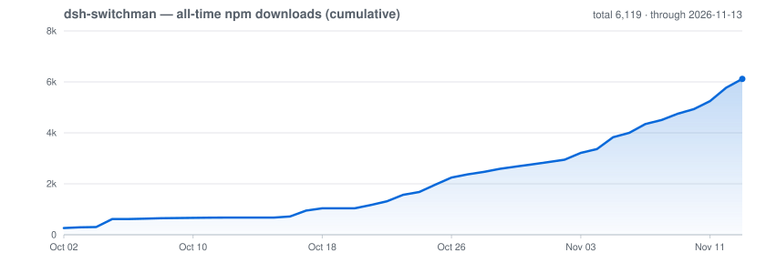

# dsh-switchman

[English](./README.md) | [简体中文](./README.zh.md) | [繁體中文](./README.zh-TW.md) | [日本語](./README.ja.md) | [한국어](./README.ko.md) | [Español](./README.es.md) | [Français](./README.fr.md) | [Deutsch](./README.de.md) | [Italiano](./README.it.md) | [Português](./README.pt.md) | **Русский**

> **Семейство switchman**, один автор, одна и та же философия диспетчеризации: [opencode-switchman](https://github.com/mrzturn/opencode-switchman) (оригинал для OpenCode) · [zcode-switchman](https://github.com/mrzturn/zcode-switchman) (порт для ZCode) · **dsh-switchman** (этот репозиторий, версия для DeepSeek Harness).


> Контекст под счётчиком. Задачи сами находят свою полосу.

## Зачем это нужно

Если работать в DSH подольше, рано или поздно упираешься в две вещи: сессия тяжелеет с каждым сообщением — история раздувает контекст до сотен тысяч токенов, модель начинает забывать, тормозить и дорожать, а ручной /compact при каждом сжатии ещё и теряет детали; и главная модель всё делает сама — прочитать файл, прогнать тест, сверить данные: всё она грызёт сама, медленно и дорого, хотя большая часть этой работы по праву досталась бы дешёвой модели.

dsh-switchman — плагин для [DeepSeek Harness](https://github.com/deepseek-ai/deepseek-harness) (DSH). После установки главная модель по-прежнему работает сама — просто делает это с большим разбором: лёгкую мелочёвку отправляет на дешёвые полосы, срочное и сложное через маршрутизацию намерений приземляет на подходящую модель, а себе оставляет только то, что действительно требует личного участия; отсекает лишнее и дистиллирует суть — переваренные участки разговора сворачиваются в компактные резюме, уровень воды следит за каждым расходом, и контекст путешествует всегда налегке; а когда нагрузка превышает одну пару рук, приглашает постоянных товарищей по команде, которые делят работу на общей доске задач, пока он занимается диспетчеризацией и приёмкой. Это не новая модель, а свод правил диспетчеризации, пристёгнутый к DSH, плюс страница настроек. Конкретно он делает девять вещей:

**1. Автоматическая обрезка контекста: сессия длиннеет, стоимость остаётся плоской.** Ручной `/compact` заставляет ждать, теряет детали и пробивает prompt-кэш поставщика. Движок обрезки автоматизирует всё это: переваренные участки разговора на границах простоя сворачиваются в компактные детерминированные резюме (пишет их side-модель; под аварийным давлением свёртка механическая, без вызова модели), и с тех пор каждый исходящий запрос собирается заново из состояния свёртки — блоки резюме замещают свёрнутые участки, живой хвост сохраняется слово в слово. Сохранённый лог сессии никогда не переписывается, и стрим в разгаре никто не трогает. Свёртки только добавляются, а сборка детерминирована: сериализованный префикс между свёртками байт в байт неизменен, и кэш поставщика продолжает попадать; любой внутренний сбой уходит в fail-open к прозрачному пропуску — битого запроса не будет. Три полностью автоматические ступени (рост / давление / авария) плюс advisory-режим, где свёртку делает сама модель — механика внизу, в разделе «Автоматическая обрезка контекста».

**2. Уровень воды в контексте: длинная сессия не переполняется.** Каждый ход подсчитывает токены сессии в реальном времени, и три линии уровня ужесточаются по нарастающей: 80k (soft, настраивается) подсказывает «пора делегировать»; 95k (hard) урезает бюджет разового чтения и подталкивает к завершению; 150k (force) запускает автоматическую передачу — записывает документ передачи (append-only лог сессии — сам по себе полная резервная копия), сжимает контекст и будит сессию, работа не обрывается. Фоновые субагенты, которые ещё бегут в момент передачи, тоже не теряются: id, описания задач и пути к отчётам записываются в документ передачи, и продолжившаяся сессия знает, куда идти за отчётами, а не раздаёт работу заново; у каждого отправленного субагента к тому же свой жёсткий потолок: доработав до него, он завершается резюме HANDOFF. Уровень воды читает вид после обрезки — то, что модель реально видит, — поэтому сильно свёрнутая сессия больше не застревает на высоких линиях. Если автоматика не по руке: `/ctx-pause` останавливает все действия (замер продолжает работать), `/ctx-resume` возвращает всё в любой момент — и после перезапуска вернётся само; `/ctx-handover` запускает ту же передачу по требованию, не дожидаясь потолка.

**3. Маршрутизация намерений: сообщение приходит — модель сама занимает своё место.** Стоит выбрать «Авто (маршрутизация намерений)» для сессии, и каждое сообщение пользователя сначала типирует маленькая модель-классификатор, приземляя его на самого подходящего кандидата — у каждого кандидата однострочная заметка о способностях, она помогает выбору. Решение закреплено за ход: пока уверенности не хватает или окно кэша ещё открыто, текущая модель остаётся (её prompt-кэш продолжает работать); переключение происходит только когда уверенности достаточно или текущей модели нет среди кандидатов. Само переключение тихое, на уровне вызова — никакого шума «модель переключена» в сессии, а чип над полем ввода показывает текущий маршрут и уверенность в реальном времени. Классификатором годятся и небольшие decision-модели, и обычные чат-модели; кандидаты, пороги и окно кэша всегда на расстоянии одной страницы настроек.

**4. Режим Agent Teams: от работы в одиночку — к своей команде.** По умолчанию выключен: сразу после установки это просто лёгкая диспетчеризация через subagent. На странице настроек два независимых переключателя: **Режим команды агентов** — при включении внедряет командный регламент (делегирование по умолчанию + многоуровневая проверка + дисциплина общей доски задач) и автоматически включает Agent Teams в DSH: главная модель может нанимать постоянных товарищей по команде (`spawn_teammate`), ставить им задачи на общей доске (`team_task_*`) и обмениваться с ними сообщениями. Когда заводить команду, решает чёткая дисциплина: параллельные независимые подзадачи, объёмная самодостаточная работа, уже высокий уровень воды в главном контексте, потребность разделить роли; разовая точечная разведка по-прежнему идёт через subagent. Если выключить переключатель обратно, от командных пунктов не останется и следа, а инструменты команды из уже работающих сессий не изымаются. **Синхронизация белого списка моделей субагентов** — в DSH есть белый список авторизации «разрешить агентам выбирать модели для субагентов»: если маршрут выбран в пуле, но не авторизован, явное назначение его главной моделью будет отклонено (в командном режиме он помечается ⚠). Включите этот переключатель — и объединение шести пулов целиком запишется в белый список: настраивать дважды не нужно, switchman остаётся единственным источником истины. Белый список применяется по снимку «новая сессия»: синхронизация действует только на сессии, открытые после неё.

**5. Шесть пулов диспетчеризации: под каждую работу — своя модель.** Лёгкий пул (economy — мелкие массовые задачи), механический (mechanical — шаблонные переработки), основной (main — повседневный кодинг), пул высокой сложности (hard — тяжёлые рассуждения и крупные рефакторинги), мультимодальный (vision — чтение картинок), пул ревью (review — независимая проверка). На странице настроек отмечаете кандидатов, расставляете приоритеты (можно с привязкой к ступеням S/A/B/C) и для каждого маршрута отдельно фиксируете reasoning effort — выпадающий список ступеней берётся из уровней, которые модель реально поддерживает, а не из трёх универсальных. Каждый ход промпт главной модели несёт с собой таблицу рекомендаций `[SWITCHMAN:POOLS]`, и работа раздаётся по ней. У режима исполнения три состояния: off / advice / enforce (enforce = модель вне пула просто отклоняется).

**6. Языковые предпочтения: спросит один раз — запомнит навсегда.** Три выпадающих списка: язык ответов, комментариев в коде и документов; область действия — глобальная или по проекту (`.switchman/lang.json`). Настраивать не обязательно: при первом использовании спросят один раз — на языке интерфейса вашего DSH — и запомнят; дальше каждая сессия соблюдает выбор автоматически.

**7. Язык интерфейса: плагин говорит и на вашем языке.** В самом верху страницы настроек появился раздел «Интерфейс» с выпадающим списком «Язык интерфейса» (ключ настройки `uiLocale`): «Авто» (по умолчанию — следует языку приложения DeepSeek Harness) или любой из языков интерфейса плагина, всегда под своим эндонимом, без перевода. Переключается только интерфейс самого плагина — значок в шапке, панель главной страницы и страница настроек, — но не язык приложения DSH: предпросмотр мгновенный, без перезапуска; сохранение запоминает выбор; следующий запуск восстанавливает его; любой сбой возвращает язык приложения; а все словари лежат внутри бандла — ничего скачивать не нужно.

**8. Многоуровневая проверка: изменено — проверено.** Изменения больше 20 строк уходят тестировщику на проверку; изменения больше 300 строк или затрагивающие ядро / безопасность / согласованность данных — дополнительно независимому ревьюеру. Модель ревьюера подбирают, привязываясь к модели агента, написавшего этот diff, и стараются её обойти; если пул другого выхода не оставляет, в заключении прямо заявляется DOWNGRADED. Скажете «не использовать команду» — всё мгновенно вернётся к одиночной работе.

**9. `/vision`: картинки по зубам даже чисто текстовой модели.** Когда главная модель не читает изображения, DSH прямо на входе отклоняет сообщения с картинками. Прикрепите картинку и введите `/vision что не так на этой картинке` — изображение будет отдано на чтение модели из мультимодального пула, а вывод вернётся в текущую сессию. Над полем ввода заранее подсказывают: «текущая модель не умеет читать изображения»; если прямая отправка картинки отклонена, она один раз автоматически переоформляется в `/vision` и уходит повторно — вручную ничего переписывать не нужно; если мультимодальный пул не настроен, команда откажется и подскажет, что настроить.

Всего одна модель? Всё равно стоит поставить — автоматическая обрезка, контроль уровня воды и многоуровневая проверка от числа моделей не зависят, и длинная сессия на одной модели выигрывает от них ничуть не меньше. Маршрутизация намерений обретает смысл только при нескольких кандидатах моделей: держите её выключенной, пока не расширите состав.

## Встроенные навыки

- **db-query** — верификация MySQL / Redis только на чтение: выполнить SQL для сверки данных, проверить ключи кэша / TTL и согласованность между хранилищами; любую запись отклоняет. При первом использовании нужна инициализация (см. ниже).
- **git-commit-message** — генерирует выдержанный в конвенциях текст коммита: только текст, git за вас не трогает.
- **requirement-docs** — единая спецификация для анализа требований / PRD / проектных документов; результаты архивируются в `docs/requirements-and-design/`.

## Быстрый старт

1. **Установите** — попросите agent выполнить установку в любой сессии, или откройте веб-страницу управления плагинами:

   ```
   plugin_manager: install_bundle  target=dsh-switchman
   ```

   или установите из локального checkout'а (режим link; после обновления нужно переустановить: `remove_bundle` + `install_bundle`):

   ```
   plugin_manager: install_bundle  target=/path/to/dsh-switchman
   ```

   или установите из терминала командой `dsh` — профиль выбирайте по способу запуска:

   ```bash
   dsh plugin --profile web add dsh-switchman      # Web GUI
   dsh plugin --profile desktop add dsh-switchman   # десктоп-приложение
   ```

2. **Перезапустите DSH** — полностью закройте приложение и откройте снова (перезагрузка страницы не считается) — только тогда таблица клиентских модулей распознает этот bundle.

3. **Настройте** — Настройки → dsh-switchman, или пункт «Диспетчерская Switchman» в боковой панели главной страницы. Вся конфигурация умещается на одной странице; вот она — проход сверху вниз, и всё готово:

   

   - **Интерфейс** — язык интерфейса самого плагина. На снимке выбран «Русский»: это мгновенный предпросмотр, вся страница переключается на месте; по умолчанию стоит «Авто» — следует языку приложения DSH. Выбор запоминается при сохранении, вернуться к «Авто» можно в любой момент.
   - **Язык** — язык того, что производит агент. Область действия на снимке — «Глобально (этот profile)» (можно и по проектам, каждый читает свой `.switchman/lang.json`); три выпадающих списка — ответы / комментарии в коде / документы — на снимке стоят на «Русский (ru)», под каждым строка состояния «сейчас: …». Можно не настраивать ничего: при первом использовании спросят один раз и запомнят.
   - **Пулы диспетчеризации** — шесть карточек в два ряда по три: сверху лёгкий / механический / основной; снизу высокосложный / мультимодальный / рецензентский. На каждой карточке отмечаются кандидаты, сгруппированные по поставщикам; отметьте «ручной порядок» — карточка станет нумерованным списком приоритетов, порядок меняется кнопками ↑ ↓ ×; рядом с каждым маршрутом можно зафиксировать reasoning effort (по умолчанию «следовать полосе»). Сводная строка сверху обновляется в реальном времени; на снимке: «пулов настроено: 4/6 · позиций в рейтинге: 2 · режим advice».
   - **Рейтинг по способностям + режим исполнения** — объединение моделей, выбранных в шести пулах, отсортировано по способности, сильнейшие впереди (на снимке glm-5.3 закреплён на ступени S, glm-5.3-flash — на A); порядок можно менять, лишние убирать; режим исполнения — advice / enforce (enforce = модель вне пула просто отклоняется).
   - **Команда агентов** — оба переключателя, командный режим и синхронизация белого списка, по умолчанию выключены; на снимке включены, под каждым — строка состояния синхронизации.
   - **Уровень воды в контексте** — три порога (на снимке 80000 / 120000 / 150000), бюджет разового чтения (3000), поведение жёсткого порога (пропустить с ограничением / заблокировать), переключатель автоматической передачи и отдельный потолок для субагентов — всё в этом разделе. Внизу строка команд: `/ctx-pause` приостановить вмешательство · `/ctx-resume` возобновить · `/ctx-handover` записать документ передачи и передать управление прямо сейчас (команда подводит сессию к границе простоя и только потом сжимает контекст, результат может занять несколько минут).
   - **Маршрутизация по намерению** — главный переключатель, маршрут маленькой модели-классификатора, тип классификатора (auto / decision / chat), независимый список кандидатов (у каждого строка описания способностей), окно кэша / порог уверенности / тайм-аут / бюджет истории и необязательная запасная модель. После включения в селекторе моделей появляется локализованный вход «Авто (маршрутизация по намерению)», а над полем ввода — чип с моделью маршрута и уверенностью.

4. **Проверьте** — в шапке сессии появился значок ⚡ «автономная команда» (рядом ◇ показывает модель текущей сессии); либо спросите модель напрямую: «как называется последний раздел твоего системного промпта?» — в ответе должен прозвучать регламент dsh-switchman.

**Инициализация db-query при первом использовании** (зависимости скриптов ставятся внутрь каталога навыка и не засоряют проект):

```bash
bash <install-dir>/skills/db-query/scripts/setup.sh
```

**Рекомендации по выбору классификатора:** чтобы развернуть модель принятия решений локально, проще всего запустить `d3:4b-mxfp8` через Ollama: выберите тип классификатора «endpoint решений (systemone)», укажите в поле endpoint `http://127.0.0.1:11434/v1/systemone`, а в поле имени модели — `d3:4b-mxfp8`. Если использовать chat-классификатор из каталога LLM, берите небольшую облачную модель или небольшую локальную модель без режима размышления (reasoning) — отключение размышления снижает одновременно и задержку, и долю сбоев по таймауту классификации.

## Конфигурация по умолчанию

Ниже — полный набор значений сразу после новой установки (авторитетный источник: zod-схема в `host/config.js`).

**Интерфейс и языки**: `uiLocale` = `auto` (следует языку приложения DSH); `langScope` = `global`; `langConversation/Comments/Docs` = пусто (спросят один раз в первой сессии и запомнят; язык комментариев и документов следует языку разговора).

**Пулы диспетчеризации**: у всех шести полос (economy/mechanical/main/hard/vision/review) кандидаты пусты (= системные модели по умолчанию, без вмешательства); ручной порядок и закреплённый effort выключены/пусты; `dispatchEnforce` = `advice` (только совет, без принуждения).

**Уровень воды в контексте**: soft `80000` / hard `95000` / force `150000` токенов; бюджет разового чтения `3000`; поведение при превышении бюджета `cap` (обрезать с предупреждением); `wmAutoHandover` = включён (на force — запись документа передачи + сжатие автоматически); жёсткий потолок субагентов = включён (общие 150k).

**Agent Teams**: `teamsMode` = выключен; `syncWhitelist` = выключен (два переключателя независимы друг от друга).

**Маршрутизация по намерению** (по умолчанию недоступна; нужны классификатор + хотя бы один кандидат + включённый главный переключатель): `intentEnabled` = выключен (пока выключен, вход Auto скрыт, а сессии, где Auto уже выбран, идут по цепочке запасных моделей); маршрут классификатора не задан; тип классификатора `chat`; список кандидатов пуст (предустановленные категории участвуют в маршрутизации, только если у них указана модель); окно кэша `300` с / порог уверенности для переключения `80` / тайм-аут классификации `60000` мс; история `6` сообщений / `2400` символов; `intentContextWindow` = `200000`.

**Обрезка контекста**: `trimEnabled` = включено; `trimMode` = `auto` (полностью автоматически); ворота роста `22500` + прирост `25000` токенов; давление `65%` / авария `95%`; advisory-напоминания `65%` / `95%`; защищённый хвост `10` сообщений; потолок частоты fold-ов `30` в час; боковая модель не задана (наследует модель сессии) — подробности в разделе «Автоматическая обрезка контекста» ниже.

**Что важно знать из коробки**: ① то, что маршрутизация по намерению недоступна из коробки, — намеренное решение; включается в три шага (классификатор, кандидаты, переключатель); ② эффективное окно Auto из коробки равно 200000 — защитная планка гарантирует 0.8×окна ≥ force (150000), поэтому линия сжатия ядра (160000) всегда стоит после линии плавной передачи (150000); ③ заметнее всего из коробки троица уровней: 80k напоминает делегировать / 95k ужимает чтение / 150k сам передаёт управление (документ + сжатие) — без каких-либо настроек.

## Автоматическая обрезка контекста

Длинные сессии остаются дешёвыми: прожитые диапазоны разговора сворачиваются (fold) в компактные детерминированные резюме — полностью автоматически и без разрушения кэша промптов провайдера. На границе простоя движок обрезки (`host/context-trim/`) выбирает диапазоны, стоящие fold, боковая модель пишет резюме (только при аварийном давлении срабатывает механический fold без вызова боковой модели), и fold фиксируется в состоянии fold-ов сессии. С этого момента каждый исходящий запрос пересобирается из этого состояния — блоки резюме заменяют свёрнутые диапазоны, живой хвост остаётся нетронутым. Хранимая сессия никогда не переписывается, и посреди стрима ничего не происходит.

Уровни автоматизации (`trimMode`):

- **`off`** — только измерения: сэмплирование расхода и попаданий кэша продолжается; без баннера и без fold-ов.
- **`advisory`** — модель сессии сворачивает сама: ей открываются инструменты `ctx_trim_fold` и `ctx_trim_status` плюс заголовок протокола. Когда давление сессии достигает `trimAdvisoryPercent` эффективного окна, движок добавляет закреплённое напоминание свернуть контекст в виде суффикса `user/message` в конец активной поверхности сессии (не в system-заголовок dispatch-а) — повторяет сразу при переходе в critical и удаляет, когда давление опускается ниже линии.
- **`auto`** (по умолчанию) — всё вышеперечисленное плюс автоматические fold-ы на границе простоя, тремя ступенями: ворота роста (рост > `trimGrowthTokens`, отсчитываемый от низшей точки после последнего fold-а — этот якорь сохраняет ворота взведёнными после fold-ов, фиксирующихся на высоких точках view — И непрерывный сжимаемый прирост ≥ `trimIncrementTokens`), ступень давления (`trimPressurePercent` окна контекста) и аварийная ступень (`trimEmergencyPercent` — механический fold с собственным охлаждением).

Все ключи живут в разделе Настройки → dsh-switchman; значения по умолчанию — из `host/config.js`:

| Ключ | По умолчанию | Смысл |
| --- | --- | --- |
| `trimEnabled` | `true` | Главный выключатель. ВЫКЛ полностью отключает fold-ы и метрики (слушатель вырождается в чистый pass-through). |
| `trimMode` | `auto` | `off` только измерения / `advisory` fold-ы по решению модели / `auto` fold-ы по решению системы. |
| `trimGrowthTokens` | `22500` | Ворота роста: fold, когда исходящая view выросла на столько с прошлого fold-а. |
| `trimIncrementTokens` | `25000` | Спутник ворот: непрерывный сжимаемый прирост тоже должен достичь этого размера. |
| `trimPressurePercent` | `65` | Ступень давления: fold, когда использование view достигает этого процента окна контекста. |
| `trimEmergencyPercent` | `95` | Аварийная ступень: принудительный механический fold (без вызова боковой модели) на этом проценте. |
| `trimAdvisoryPercent` | `65` | Линия advisory-напоминания: при достижении этой доли эффективного окна движок предлагает модели немедленно сложить контекст через `ctx_trim_fold` (только режим advisory). |
| `trimAdvisoryCriticalPercent` | `95` | Критическая линия: при её достижении напоминание повторяется сразу, минуя 10-минутный троттлинг той же полосы. |
| `trimWindowTokens` | `0` | Эффективный лимит окна для расчёта уровней: считается от min(окно модели, лимит). `0` = следует за `wmForceTokens`. |
| `trimProtectedTail` | `10` | Последние N сообщений никогда не сворачиваются. |
| `trimMaxFoldsPerHour` | `30` | Потолок частоты fold-ов боковой модели за скользящий час (аварийные не в счёт). |
| `trimSideModel` | не задан | Маршрут боковой модели, пишущей резюме. Пусто = следовать provider/model сессии, не наследуя effort вызова; этот маршрут также используют ladder distillation. Effort резюме можно закрепить отдельно; без фиксации метаданные модели определяют минимальный доступный уровень reasoning, а для моделей только с переключателем вкл./выкл. выбирается off. Если reasoning не поддерживается или метаданные недоступны, effort не отправляется и сохраняется поведение модели/адаптера по умолчанию. |
| `trimFoldFallbackModel` | не задан | Маршрут повторной попытки, если боковая модель резюме не сработала; pressure-fold затем деградирует до механического. Пусто = без резерва. У вручную выбранной запасной модели fold-а независимый effort; если он не задан, применяется та же рекомендация по метаданным, что для модели резюме, а при отсутствии метаданных — умолчание самой модели. Выбирайте маршрут с запасом по кулдаунам, риск-контролю и параллелизму. |
| `trimStateDir` | не задан | Переопределяет каталог состояния fold-ов. Пусто = `<dshHome>/.dsh-switchman/state/trim/`. |
| `surfaceFold` | `true` | Доставляет зафиксированные fold-ы на поверхность сессии (пара событий: учёт shadow-price + replace с `surfaceOp`). OFF оставляет view только со сплайсами. |

**Пути срабатывания.** Проверки ступеней выполняются на границе простоя и — как запасной путь для хостов, где события статуса простоя недостижимы — после завершения каждого потока модели (не чаще одной оценки в 60 с на сессию). Каждое решение — и fold-ы, и no-op-ы — дописывается одной строкой `key=value` (с отметкой времени) в `decisions.log` внутри каталога состояния fold-ов (см. `trimStateDir`), что даёт fold-ам офлайн-журнал аудита; словарь строк (`view-applied`, строки решений/исходов fold-ов, `surface-replace`, `surface-replace skipped reason=…`) перечислен в [docs/context-trim.md](./docs/context-trim.md).

**Правда провода и установившийся режим.** Строки решений несут `view=<n>` и, после того как ответ пришёл, `wire=<n>` — реальный промпт провайдера (некэшированный вход + чтение кэша + запись кэша, сэмплированные из usage-события потока). Оценка view считает только массив сообщений и всегда читается меньше провода на фиксированный оверхед (измерено ≈ 17.3k: системный промпт + схемы инструментов + persona), поэтому ступени давления и аварии оценивают по `max(view, wire)`, и только `wire` — это измерение размера промпта. На окне 150k здоровая пилообразная кривая ведёт провод от ≈ 40k сразу после fold ↔ 64–97.5k на следующем (≈27%–65% окна), один fold на ~25k сырого прироста, причём потолок удерживается около 97.5k ступенью давления, а не окном. Если `view` растёт, а строка `surface-replace` так и не появляется, читайте строки пропуска (`incomplete-seqs`, `no-service`, `compaction-lock`).

**Эпохи сжатия на стороне хоста.** Ссылки fold привязаны к идентификаторам сообщений и хешам содержимого, поэтому сжатие, выполненное самим хостом и заменяющее повторно отправляемую историю, старит весь журнал разом: ни один блок не находит своей позиции, view молча откатывается к исходной истории (fail-open — в журнал решений записывается `view-applied applied=0`), а плагин при следующем запросе перепривязывает базовую линию роста к виду после сжатия. Таким образом, сжатие хоста — запасной слой обрезки последней инстанции, а fold плагина выполняет тонкую работу внутри одной эпохи хоста. Некоторые диспетчеры передают полностью замороженные массивы запросов или объекты опций (текущий агентный луп глубоко замораживает собранные запросы); для них `injectView` фиксирует исход в журнале решений: `nothing-to-apply` (ни одного найденного fold-блока — сырая история и ЕСТЬ view), `in-place`/`swapped` (свёрнутое представление ушло с запросом) или `none` (fold существовал, но замороженный диспетчер не смог его нести — по проводу идёт сырая история). **Surface replace — путь доставки, когда он доступен** (`surfaceFold`, по умолчанию включён): на серийной границе `agent/turn-stopping` плюс холостая проходка плагин дописывает хост-стильное событие учёта shadow-price и ОДНО замещающее событие `user/message` с `surfaceOp {op:'replace', startSeq, endSeq}`, где `sourceEventSeqs` покрывает каждый затенённый узел поверхности, — тот же механизм, которым пользуется сжатие самого хоста, — так что зафиксированный fold доходит до провода с уровня источника, замороженные диспетчеры включительно. Пока недавние диспетчеры сессии пишут `none`, плагин считает view чисто измерительным: уровень воды вместо этого меряет присланную провайдером сумму (ступень force и автоматическая передача продолжают работать), циклы fold-ов приостанавливаются, не сжигая вызовы суммаризатора, а баннер обрезки помечает строку `wire=raw` (folds not shipping; watermark reads the tally); хосты без surface-механизма (или с выключенным флагом) сохраняют ровно это прежнее поведение.

**Как fold-ы берегут попадания кэша.** Каждый fold один раз переплачивает префикс; цель — амортизированная стоимость, а не стопроцентное попадание. Движок соблюдает контракт кэша: fold-ы только добавляются — frontier движется только вперёд, замороженная зона больше не редактируется; view пересобирается детерминированно из (история, состояние fold-ов), поэтому сериализованный префикс между fold-ами остаётся побайтово тем же и кэш провайдера продолжает попадать; границы fold-а никогда не разрывают пару tool-call ассистента и его результат; последние `trimProtectedTail` сообщений освобождены от свёртки; и всё отказывает открыто — внутренняя ошибка вырождается в pass-through, но не в сломанный запрос.

**Арбитраж компакции.** Два автоматических триммера поверх одной истории резюмировали бы её дважды и разрушали бы frontier друг друга, поэтому `cordis.patch.yml` ставит `auto: false` на строки `dsh-compaction-basic` хоста: context-trim становится единственным смысловым триммером. Ручной `/compact` продолжает работать, а передача уровня force (она одалживает именно этот ручной путь) остаётся нетронутой. Восстановление после переполнения переходит к обрезке: попытка сверх окна падает один раз, затем аварийная ступень сворачивает view, чтобы следующая попытка поместилась.

**Наследование при fork-е.** Форкнутая сессия (fork субагента) наследует состояние fold-ов родителя по принципу copy-on-fork — но только если состояние родителя существует и история ребёнка реально разрешает frontier родителя; иначе ребёнок стартует с чистого листа. Одно наследование на ребёнка, идемпотентно между перезапусками.

**Баннер уровней читает view.** Баннер уровней показывает число токенов исходящей view (то, что модель реально видит после свёртки) вместо накопленного счётчика, так что сильно свёрнутая сессия больше не пригвождает уровень к ступени hard.

## Как это работает

- Host-половина (`index.js` + `host/`) внедряет побайтово стабильные секции системного промпта (язык / полосы / протокол уровня воды / команда) плюс живую строку уровня через хвостовой runtime-context-снимок (канал, который только дописывает, а не переписывает начало промпта, поэтому промпт-кэш поставщика остаётся целым), а также двойной шлюз бюджета чтения и enforce и четыре слэш-команды (ctx-тройка + `/vision`). Все настройки после сохранения вступают в силу при следующей сборке промпта — без перезапуска.
- Client-половина (`client.js`) отрисовывает страницу настроек, значок ⚡ и метку модели ◇ в шапке сессии, живую подсказку во время передачи управления; снимки конфигурации читаются и записываются через семейство маршрутов Host.
- Пункт «Диспетчерская Switchman» в боковой панели главной страницы: один клик открывает эту же страницу настроек в виде центральной панели; прежний вход в настройки остаётся на месте.
- `cordis.patch.yml` целиком сохраняет список плагинов заводских пресетов и расширяет только persona suffix; сами инструменты Agent Teams приходят из заводского bundle и автоматически включаются вместе с командным режимом.

## Обслуживание

- Если после обновления DSH изменился список плагинов заводских пресетов, пересинхронизируйте `cordis.patch.yml` из новых `presets/*.patch.yml` (сохранив doctrine suffix и арбитраж компакции — `auto: false` в строках `compaction-basic`) и переустановите.
- Строки протокола (`[SWITCHMAN:LANG|POOLS|WATERMARK|TEAMS]`) намеренно оставлены на английском и стабильны побайтово — не локализуйте их.
- `npm pack --dry-run` должен сохранять аудированную форму: 60 файлов / ~380 kB (~1,26 МБ распаковано; `docs/` исключён).

## Загрузки

Все загрузки npm с момента первого релиза, накопительно — построено по официальному [npm downloads API](https://api.npmjs.org/) и ежедневно обновляется GitHub Actions ([скрипт графика](scripts/downloads-chart.mjs)):



## License

MIT
